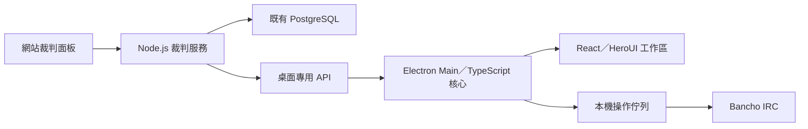

# OCLR 裁判面板與 OCLR-ref-tools 整合設計

- 文件 ID：`oclr-referee-panel-integration`；文件版本：0.1.0；日期：2026-10-27（Asia/Taipei）。
- 狀態：跨專案設計草案；記錄方案不等於 API 已實作、已部署或新 scope／MVP 範圍已確認。
- 同步位置：OCLR-ref-tools 與 OCLR-website 各自的 `docs/referee-panel-integration.md`；兩份正文保持一致，修訂時同步版本與內容。
- 範圍：資料契約、權責、桌面操作與分期交付。本文件不新增程式、migration、真實授權、issue 認領或部署。

## 1. 依據與目前狀態

來源為 [網站 Epic #312](https://github.com/OCLR-dev/OCLR-website/issues/312) 及 #313–#317、2026-10-27 查閱的留言。Issue 本文部分仍寫待開發；[本地實作進度留言](https://github.com/OCLR-dev/OCLR-website/issues/312#issuecomment-6411703459) 回報已有本地首版、尚未推送／部署且等待使用者審閱。這是來源回報，不是本文件作者重新執行的驗收，也不能當作正式 API 可用證據。

最新 UI／政策回報包括：

- [三階段導航](https://github.com/OCLR-dev/OCLR-website/issues/315#issuecomment-6437945223)：賽前準備、BP 階段、賽後計算；本文件將最後階段的整合責任稱為「賽後核對」。
- [賽前命令列](https://github.com/OCLR-dev/OCLR-website/issues/314#issuecomment-6438575657)：五條緊湊命令、逐條複製及複製狀態；內容改變後重設，複製不產生業務寫入。
- [可配置重賽上限](https://github.com/OCLR-dev/OCLR-website/issues/316#issuecomment-6438077639)：本地預覽值不是全站預設；同理 BO9、3v3、圖池與先後手示例均不能當正式規則。

桌面已確認沿用 Electron、TypeScript／Node.js 核心、React 與免費 HeroUI，不遷移 Go。OCLR 伺服器以既有 Node.js／Next.js／TypeScript／PostgreSQL／Drizzle 實作。桌面目前 0.2.0 是 IRC 聊天與唯讀查詢增量，尚未完成 OCLR 授權、操作佇列與面板接入。

既有桌面基線：[授權草案](https://github.com/OCLR-dev/OCLR-ref-tools/blob/main/docs/contracts/desktop-authorization.md)、[context 草案](https://github.com/OCLR-dev/OCLR-ref-tools/blob/main/docs/contracts/referee-context-api.md)、[MVP 任務](https://github.com/OCLR-dev/OCLR-ref-tools/blob/main/docs/mvp-plan.md)。它們尚未正式發布；本文件提出增量，不默默改寫既有只讀 scope、D03 本人指派或 D07 單一主控決策。

## 2. 整合原則與權責

取得同一份結構化裁判面板資料，在桌面本地呈現；不抓取管理頁 HTML、不匯入網站 cookie，也不讓遠端 iframe 直接呼叫 Electron IPC。



| 部分 | 權責 |
| --- | --- |
| OCLR 服務 | 身分、指派、政策、選禁合法性、追加事件、暫記比分、版本與 MP 核對 |
| Electron Main | 桌面 token、API、IRC 狀態、固定房間操作計畫、節流、防重送及安全儲存協調 |
| Renderer | 顯示、預覽、人工確認；不持有 token、任意網路／檔案能力或任意 IPC |
| 既有結果服務 | MP 匯入、裁判提交、Admin 核准／發布；保持唯一正式結果來源 |

優先抽出網站已有的 DTO／執行期 schema、純命令 builder 與測試向量供雙端重用；不複製 DB 查詢或另建賽事權威服務。共用 package 的輸出不得依賴 Next.js server、資料庫或秘密。伺服器始終重新檢查流程與規則，不信任客戶端 builder。共享視圖元件僅在可乾淨隔離時採用，不強行共用網站 layout／cookie runtime。

## 3. 三階段工作區與操作語意

| 階段 | 顯示資料 | 桌面操作 |
| --- | --- | --- |
| 賽前準備 | 場次、隊伍／隊長、直播員、規則、房名、計時設定 | 開房或綁定、房間設定、邀請；addref 另核對建立者權限 |
| BP 階段 | 獨立先 Ban／先 Pick、有限步驟、圖池、attempt、暫記比分 | 記錄選禁、切圖／Mods、計時、開始／中止 |
| 賽後核對 | ledger、保存的 MP game、來源指紋與差異 | 明確建立核對關係，返回網站提交／審核 |

始終分開「選中圖譜」「複製命令」「傳送 IRC」「記錄 Ban／Pick／勝負」。任一動作不隱含其他動作。初期不提供把遠端記錄與 IRC 命令綁成一個原子按鈕的假象；兩個系統沒有分散式原子交易。

先 Ban、先 Pick 各存本場 team ID，可獨立未設定；不從紅藍、主客、擲骰推定。暫選即時預覽，明確套用才保存；修改已發生步驟必須按網站規則撤回後續紀錄，不重標既有隊伍或勝方。

重賽建立原 Pick 的下一個 attempt，不多消耗 Pick；平手、中止、未完成、撤回或被取代嘗試不自動加分。政策未配置時保持阻擋，不從參考賽季猜測 TB、NF、FM、EX 或重賽上限。

「已複製」僅代表剪貼簿成功。IRC 操作狀態為 queued／sending／awaiting／success／failure／unknown；success 需具體 Bancho 證據，不以本機 echo、複製變灰或寫入 receipt 替代。

## 4. 認證、scope 與資源邊界

沿用桌面授權草案：外部系統瀏覽器、一次性 code、S256、loopback、Main 記憶體 token、single-flight refresh、撤銷與 generation。上游 osu! secret 留在網站後端。網站 cookie 管理 API、Developer saved-read `/api/v1` 與桌面 Bearer API 保持不同認證邊界。

| Scope | 用途／狀態 |
| --- | --- |
| `referee:fixtures:read` | 既有草案：本人場次 |
| `referee:context:read` | 既有草案：操作 context |
| `referee:panel:read` | 新提案：私密面板、歷史及核對讀取 |
| `referee:panel:write` | 新提案：本場設定、先後手、執裁事件 |
| `referee:reconciliation:write` | 新提案：保存核對關係，不授權 provider 匯入、提交或發布 |

新增 scope 須在授權頁明確同意，refresh 不能擴權；舊 client 保留原有只讀能力。每個讀寫與 receipt 查詢均重查有效帳號、scope、edition 能力、本人指派與資源歸屬。桌面 Admin 仍只讀寫本人獲派場次，不繼承網站 Admin 的全版次管理能力。Developer、Streamer、Captain 或 repository 身分均不能替代裁判資格。

未指派／不存在／失去本版次資格的資源統一 404；全部裁判資格撤銷為 403。撤權即清受影響 context、面板、待操作與受管理歷史，不能靠 receipt 或本機快取繞過。寫入拒絕外來 actor、角色、ordinal、比分或官方結果欄位。

## 5. HTTP 通用契約與端點

沿用 `https://oclr.org/api/desktop/v1` 授權基底及 `https://oclr.org/api/referee/v1` 業務基底。下表路徑均相對後者，全部是待對齊網站服務的提案。

| 方法／路徑 | 功能 | 必要 scope |
| --- | --- | --- |
| `GET /me/fixtures` | 本人場次與面板摘要／入口 | fixtures:read |
| `GET /fixtures/{id}/panel` | 原子 context＋面板快照 | context:read、panel:read |
| `GET /fixtures/{id}/panel/events` | 執裁歷史分頁 | panel:read |
| `PATCH /fixtures/{id}/panel/settings` | 本場房名、計時等可調整欄位 | panel:write |
| `PUT /fixtures/{id}/panel/order` | 獨立先 Ban／先 Pick | panel:write |
| `POST /fixtures/{id}/panel/events` | 有限事件 mutation | panel:write |
| `GET /fixtures/{id}/panel/mutations/{key}` | 本人該次 mutation receipt | panel:read |
| `GET /fixtures/{id}/panel/reconciliation` | 已保存 MP 來源與工作紀錄差異 | panel:read |
| `POST /fixtures/{id}/panel/reconciliation` | 明確核對關係／確認 | panel:read、reconciliation:write |

表中 scope 省略共同 `referee:` 前綴。需要面板寫入的 client 同時申請 panel:read。伺服器依操作判定實際 capability；scope 不是繞過領域授權的通行證。

- JSON envelope：`{ data, meta: { apiVersion, contractVersion, requestId, serverTime } }`；錯誤 `{ error: { code, message, requestId, retryable } }`。
- 保持 camelCase、UTC RFC 3339、UUID 領域 ID、正 safe-integer osu!/beatmap/room ID、opaque revision 與明確 null。未知 enum／必要語意阻擋相關功能。
- `Cache-Control: no-store`、`X-Request-Id`、`X-OCLR-Referee-Contract`；不把 Bearer 放 URL／renderer／日誌，不對私密回應做公開快取。
- 擴充版本候選為 `1.1.0`，並非已發布號碼；舊 `/context` 不改 shape 或突然接受 query。新增 panel 端點避免破壞原本無 query 的 context 契約。
- GET 不建立 session、不寫業務資料、不抓上游、不匯入 MP。第一次明確合法保存才依網站服務建立 fixture 唯一 session。
- 建議 mutation JSON 上限 8 KiB、panel 512 KiB、events 單頁 100 筆／256 KiB，對過大回應明確報錯而非截斷為成功。limit 預設 50、1–100；未知／重複 query、未知 request 欄位或錯誤型別回 400。
- 繼承讀取 120 次／session／分鐘候選值；寫入另設 30 次／session／分鐘候選值。429 帶 Retry-After，需在副作用前產生。實際數字須以後端負載與操作測試定版。

## 6. 面板一致快照

`GET /fixtures/{id}/panel` 不接受 query。回傳同一一致性邊界內的 `context` 及以下面板資料，桌面不與另一輪舊／新 `/context` 拼接。

| 欄位 | 語意 |
| --- | --- |
| `context` | 完整沿用既有 context 草案及 contextRevision／sourceVersions／freshUntil |
| `panelRevision` | 面板狀態及相關依賴指紋的 opaque revision，時間流逝不自行改號 |
| `session` | 尚未建立為 null；存在時提供穩定 ID，不回傳秘密 |
| `order` | firstBanTeamId、firstPickTeamId，各自可 null |
| `workflow` | 有限步驟、目前 step、行動 team、合法 entry 與阻擋原因 |
| `attempts` | 當前所需有界投影；歷史使用 events 分頁，不默默截斷必要狀態 |
| `provisionalScore` | 由有效事件聚合的裁判暫記比分，與 official result 分開 |
| `commandOptions` | 可準備的命令種類、具型別參數、來源版本與缺項 |
| `capabilities` | 此 actor 現在可保存的面板動作，不代表 Bancho 權限 |
| `issues` | 穩定錯誤碼與欄位定位；顯示文字不作機器判斷 |
| `capturedAt`／`freshUntil` | 整份面板快照的時間；有效期不得超過內含 context |

`panelRevision` 必須包含 session 不存在時的確定版本語意。兩個首次保存競爭仍由 fixture 唯一約束／交易序列化，不能各建 session。政策、隊伍、圖池、指派或來源變動會使對應預覽與計畫失效。

events cursor 綁 actor、fixture、排序及 panelRevision，5 分鐘有效；revision 改變回 409 COLLECTION_CHANGED，客戶端最多自動重開一輪分頁。GET events 不能取得其他場次的事件。

## 7. 命令資料及本機執行

API 回傳具型別的資料，任意 raw command／JavaScript／HTML 不具執行權。下例僅是 `commandOptions` 中選圖資料片段，不是完整 panel response；全部 ID 為合成值。

```json
{
  "kind": "select_map",
  "entryId": "00000000-0000-4000-8000-000000000301",
  "beatmapId": 900000001,
  "ruleset": "osu",
  "modsProfile": { "roomMods": ["HD", "NF"], "freemod": false },
  "sourceContextRevision": "ctx_example_12"
}
```

`modsProfile` 的最終 wire shape 必須對齊既有 context profile，以上為意圖示意，不另立平行 Mods 權威。category 不等於完整 Mods；未知或不完整 profile 阻擋自動操作。網站可支援較多 mode，但桌面 P0 的 osu! standard／H2H 1v1／Team VS／Score V2 範圍不因取得資料而擴張。

九類 make／set／addref／invite／timer／map／mods／start／abort，由 Main 的 allowlist 與共用 builder 轉成 IRC 行；限制控制字元、位元組長度與參數。建立者限定的 addref 不混入普通 room_permission；若需新的 `add_referee` intent，另擴充 schema／檢查，不能借 configure_lobby 略過限制。make 發給 BanchoBot；其餘房間操作綁固定已驗證 channel。

執行順序：取得新鮮 context → 核對帳號配對、MP History、裁判／建立者權限及本地快照 → 顯示預覽 → 使用者確認 → 共用佇列 → 核對 Bancho 回覆。create_lobby／start_game 依既有契約先重讀；切圖與 Mods 兩步都核對才成功。若 map 成功、Mods 失敗，顯示部分完成而非回滾成功。

沒有伺服器「送 IRC」端點，不從 API 回應自動倒數。送出後斷線標 unknown，禁止自動重播 make／start／abort／close。IRC success 不自動新增 Pick、attempt 或勝方；反之保存事件成功不證明 IRC 已執行。

## 8. 寫入、事件與冪等

所有 mutation 帶 `Idempotency-Key: <UUID>`、`expectedRevision`（panelRevision）、`expectedContextRevision`。伺服器在同一交易內驗證目前身分、scope、指派、依賴、步驟與規則，寫追加事件、聚合 revision 及既有自動稽核。沒有例行 Audit Reason；領域需要的修正說明依網站既有契約，不另製通用理由欄位。

```http
POST /api/referee/v1/fixtures/{fixtureId}/panel/events
Authorization: Bearer <desktop-access-token>
Idempotency-Key: <UUID>
Content-Type: application/json
```

```json
{
  "expectedRevision": "panel_example_18",
  "expectedContextRevision": "ctx_example_12",
  "type": "pick_recorded",
  "payload": {
    "stepId": "step_04",
    "teamId": "00000000-0000-4000-8000-000000000201",
    "entryId": "00000000-0000-4000-8000-000000000301"
  }
}
```

```json
{
  "data": {
    "receiptId": "00000000-0000-4000-8000-000000000501",
    "eventId": "00000000-0000-4000-8000-000000000502",
    "panelRevision": "panel_example_19"
  },
  "meta": {
    "apiVersion": "1",
    "contractVersion": "1.1.0",
    "requestId": "00000000-0000-4000-8000-000000000503",
    "serverTime": "2026-10-27T10:00:00Z"
  }
}
```

回應是 mutation receipt，不是完整最新 panel；成功後重讀面板。`meta.requestId` 為伺服器追蹤 ID，與客戶端 idempotency key 不同。命名及 UUID／opaque step ID 的實際映射，須對齊網站已實作 DTO 後再凍結。

| 動作 | payload 核心及限制 |
| --- | --- |
| settings | 僅本場允許調整的房名／計時，PATCH 明列欄位；不可寫全輪規則、隊長 UID 或權限 |
| order | firstBanTeamId、firstPickTeamId；互不連動，已有紀錄時套用網站衝突規則 |
| ban_recorded／pick_recorded | stepId、teamId、entryId；伺服器核對行動隊與合法選擇 |
| attempt_started／resolved | 引用 pickEventId／attemptId；結算提供有限 outcome 及必要 winnerTeamId，平手／中止不帶勝方 |
| replay_requested | 原 pick／attempt 引用；伺服器核對可重賽狀態及配置上限，建立新 attempt，不消耗 Pick |
| attempt_corrected | attemptId 與合法修正；保留前後值與 actor，不覆寫歷史 |
| event_voided | 目標 eventId；依網站規則逆序撤回，禁止破壞後續依賴 |

事件名稱除來源已有者外仍為候選，實作前映射到網站服務的有限 discriminated union；不開放任意 JSON 或客戶端整份 ledger 覆寫。結果為官方已提交／核准狀態時，工作紀錄修改遵守網站原有保護，不改寫正式 result revision。

冪等處理順序：先驗目前存取資格 → 查 actor＋fixture＋操作＋key → 若已有相同 payload 的 receipt 直接回原結果 → 否則驗 revision／依賴並原子執行。同 key 不同 payload 拒絕。不能先以舊 expectedRevision 拒絕已成功的同 key 重試。

建議 receipt 至少保留 24 小時，期限及回查結果需明確；網路不明先查 receipt，在保證窗口內只以原 key／原 payload 重試，不新建 key。404 不能直接當作「沒有寫入」：可能不存在、過期或已無權；仍有權且在保證窗口才可走同 key 有界恢復，窗口外要求人工核對。系統不宣稱跨無限時間 exactly-once。

## 9. MP 核對與正式結果

讀取及保存核對均引用已保存的 import/source/game/fingerprint；reconciliation mutation 另帶 `expectedSourceRevision`。使用 attemptId 與來源穩定 ID 明確關聯，拒絕重複關聯或模糊配對。相同 beatmap 的重賽不得按 beatmapId 去重；資料缺失保持待確認，0 分與缺值分開。

ledger 或來源變動即使舊確認失效，不能默默覆蓋另一方。技術判分沿用既有 review，不捏造 MP game／選手成績／Rating。桌面首期提供既有 review URL，裁判提交與 Admin approve／publish 留在網站；GET／核對保存不觸發 provider 更新、公開比分、bracket、standings 或 OBS 變更。

## 10. 同步、錯誤與本機資料

前景 15 秒、背景 60 秒輪詢；恢復焦點先重讀，同一 generation／fixture 合併請求，遵守 Retry-After。輪詢下限不阻擋必要 preflight。回應及寫入結果綁登入／場次 generation，切帳號或場次後舊回應不得回填。後續若採 SSE，仍須驗權及完整快照恢復，不在首期承諾。

| HTTP／code | 行為 |
| --- | --- |
| 400 INVALID_REQUEST | 格式／未知動作／欄位錯誤，不自動重試 |
| 401 ACCESS_TOKEN_EXPIRED | 依授權契約 single-flight refresh；mutation 只能維持原 key，不盲目重送 |
| 401 SESSION_REVOKED／SESSION_EXPIRED | 清私人資料與待操作，重新授權 |
| 403 INSUFFICIENT_SCOPE | 停用對應功能，明確新增授權，不 fallback cookie |
| 403 REFEREE_ACCESS_REVOKED | 全域失去資格，清關聯資料 |
| 404 FIXTURE_NOT_AVAILABLE | 清該場資料；不存在與越權不區分 |
| 409 REVISION_CONFLICT／DEPENDENCY_CHANGED | 重讀、顯示差異、要求重新確認，不自動覆蓋 |
| 409 IDEMPOTENCY_CONFLICT | 同 key 不同 payload，停止並檢查客戶端狀態 |
| 409 COLLECTION_CHANGED | 有界重開歷史分頁 |
| 422 ACTION_NOT_ALLOWED | 步驟／隊伍／圖譜／重賽上限不符，回傳機器可讀原因 |
| 429 RATE_LIMITED | 副作用前回覆，依 Retry-After 等待 |
| 5xx／網路逾時 | 結果可能不明；查 receipt，禁止產生新 key 補送 |

面板 revision 處理網站／桌面並發寫入，不是 IRC 控制鎖。D07 單一主控不變：首期不宣稱支援多裝置同時控制同一 Bancho 房間；需要分散式執行鎖時另立設計。

離線停止 OCLR 寫入，不建立可日後自動補送的選禁佇列。記憶體可保留明確的本次 mutation key 與不明狀態，重啟後不自動重建／重送。完整 context／panel 不持久保存；D06 加密日誌與最小恢復記錄沿用桌面原契約，未完成 LOG-01 前不宣稱已保存。

## 11. 分期、相依與驗收

| 階段 | 交付 | 前置條件 |
| --- | --- | --- |
| PANEL-R | 只讀接入：桌面登入、本人場次、panel、三階段視圖、命令預覽／複製 | 網站 #313–#317 共用服務穩定、AUTH／CTX 及只讀 scopes 定版 |
| PANEL-X | 本機 IRC 快捷執行與逐步核對 | CORE／STATE／LOG、指定測試房 mutation 驗證、模式與權限 gate |
| PANEL-W | 本場設定、先後手、選禁與 attempt 雙端共用紀錄 | 額外寫入 scope、交易／冪等／並發契約及 DB 驗證 |
| PANEL-C | 保存 MP 核對關係，回網站正式提交 | 網站 #317 服務、來源版本與獨立 reconciliation 權限 |

這是整合子階段，不替代既有 M0–M4。寫入、Ban／Pick 等原為桌面 P1，需另確認納入哪個 milestone；不能因寫入設計已記錄就自動擴大 P0 或標完成。只有既定 milestone 真正完成，才依桌面規則自動 tag／push。

必要驗收：

- 網站與桌面對同一輸入產生相同命令、流程與暫記投影；四種先後手、多階段 Ban、未知政策與 TB 邊界。
- 相同 revision 競爭只成功一次；首次建立 session 競爭、同 key 同／不同 payload、回應遺失、過期 receipt、撤權後回查。
- Pick 方與勝方不同、平手／中止／多次重賽、超限無寫入、逆序撤回、來源變動後重新核對。
- 切房／切帳號後晚到回應不回填；map 成功而 Mods 失敗；在途斷線不重送 make／start／abort。
- 未指派／跨版次／僅 Developer 或 Streamer 不可寫；所有 GET 無業務寫入，暫記不影響公開結果。
- 端點不存在／HTML／未知契約保持不可用，不抓管理頁或回退網站 cookie。
- 合成測試、隔離 PostgreSQL、三平台桌面、真實指定房間及正式 OAuth 證據分開記錄。單元／原型通過不能代替實機或正式授權驗收。

## 12. 實作前待定事項

1. 與網站可取得的實作 commit 對齊 DTO、revision、事件名稱及已有服務，確定共用 package 範圍；目前留言不是可下載的正式發布契約。
2. 新增 scopes、contractVersion、保留期限／限流／payload 上限及 namespace 定版；既有只讀授權不被擴權。
3. PANEL-W／C 的產品排程與 milestone 歸屬；單一主控及正式發布邊界維持不變。
4. addref 建立者證據、#UID、完整 map／Mods／Start 核對與平台支持補足後，才開放相應執行功能。
5. staging／合成測試資料／正式端點可用性由網站團隊提供，不索取或寫入真實秘密。

## 13. 來源

- [#312 整體設計](https://github.com/OCLR-dev/OCLR-website/issues/312)
- [#313 工作階段、契約與權限](https://github.com/OCLR-dev/OCLR-website/issues/313)
- [#314 命令複製](https://github.com/OCLR-dev/OCLR-website/issues/314)
- [#315 獨立先後手與流程](https://github.com/OCLR-dev/OCLR-website/issues/315)
- [#316 選禁、attempt、重賽與修正](https://github.com/OCLR-dev/OCLR-website/issues/316)
- [#317 MP 核對與審核](https://github.com/OCLR-dev/OCLR-website/issues/317)
