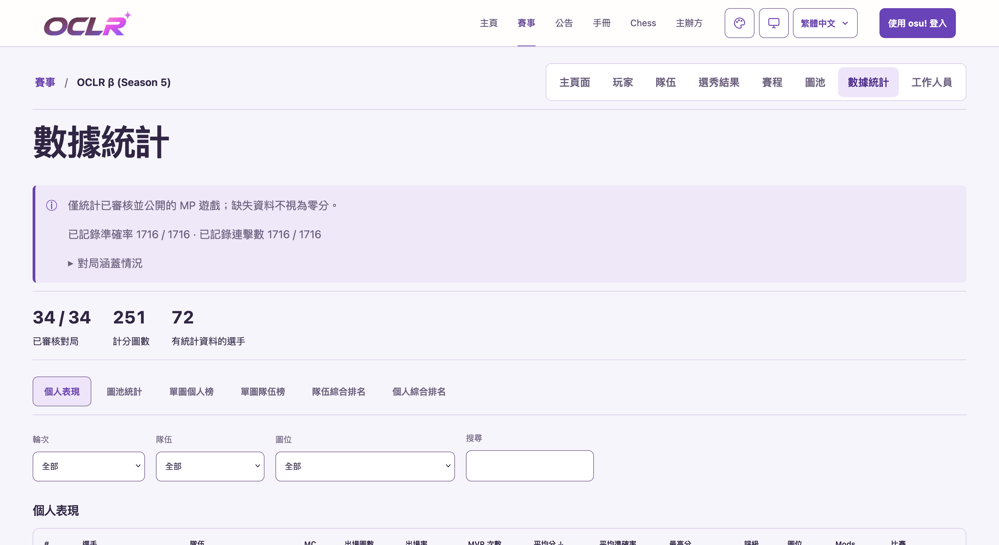

# S5 統計匯入、核准與發布

2026-10-31，對應 [#610](https://github.com/OCLR-dev/OCLR-website/issues/610)。
主辦者明確授權依現有證據修正 Reecho 與三名隊長 UID，B28／GF 沿用已核准比分並保留差異，完成統計匯入、覆核與發布；另確認可為重新匯入暫時隱藏 S5 並立即恢復公開。

## 已完成操作

- 透過既有 edition Admin 介面修正四筆身分：Reecho `1262507` → `12624507`；Azureus → `6938658`；My_Suck_Aim → `2361632`；moe_nyannyan → `4087427`。三名隊長保留 Captain／Tier 0。
- 在三名隊長完成修正後回讀 revision 20，從**當時實際保存的完整歸檔**準備 Reecho 修正檔，沒有拿早期 pending 匯入包覆蓋站上資料。依主辦者確認暫時取消公開、驗證並保存修正檔，隨即恢復公開，最終 revision 23、`published=true`。
- 保存的歸檔與經 schema 驗證的上傳檔逐欄完全一致；34 場既有比分及 approval 物件、12 隊排名表、其他 edition 欄位全部保留。B28／GF 新增 rawScore 與主辦者本次決策附註，sourceFacts 另保留四筆身分更正與兩場差異的紀錄。
- 透過原生統計匯入器取得全部 34 個 MP 的完整正規化來源；逐場核對選局、名單與例外，再分別操作「核准並公開」及確認。最終 34 筆 summary 都有 publishedAt，`changes=false`、`stale=false`。

## 計分與原始資料保留

已審核的選局逐場與[全量離線核對](s5-statistics-audit.md)的 251 個候選 ID 一致。18 個未完成紀錄與 63 個階段圖池外紀錄沒有計入；沒有將所有圖池外紀錄一概稱作暖身或重打。

名單內的 1,716 筆成績全部保留，包含 217 筆零分及 WhiteCookies 的 16,059 分。只排除已核對為非選手／不在該場雙方選手名單的 291 筆紀錄，涉及 12 個 UID；其中唯二正分是 Sonoaoi 的 13 分與 buhei 的 3 分。排除是統計 review 決策，沒有刪除來源成績、替換 UID 或修改分數。未解析教練的身分提案沒有因此套用。

九個遊戲中的名單內零分紀錄有房間顏色與已確認隊伍不一致的情況。經逐 UID 核對後，使用原生 Admin「使用已核對的名單雙方歸屬」控制；原始顏色保留。遊戲 ID 見[逐場發布證據](verification/issue-610-s5-publication/result.json)。

| 場次 | 已核准系列賽比分 | 實際 MP 計分局勝圖 | 已公開計分局 |
|---|---|---|---:|
| B28 · A–H | 6:2 | 5:3 | 8 |
| GF · G–I | 7:4 | 8:3 | 11 |

兩場均依主辦者明確指示啟用既有技術判分覆核選項；不推寫具體 Team Fail 原因、不挑一局改判、不補造玩家技術分。歸檔保留正式比分、rawScore 和決策附註；公開詳情同時顯示正式比分、已審核實戰勝圖數與技術提示。

## 實際驗證

- 獨立 Firefox 隱私視窗顯示「使用 osu! 登入」，確認為未登入；[公開統計頁](https://oclr.org/tournaments/s5/statistics)顯示 **34／34 場、251 局、72 位選手、1,716／1,716 準確率及連擊數**，四個更正後的 UID 連結正確。
- 公開涵蓋清單 34 項均為已公開；[B28 詳情](https://oclr.org/tournaments/s5/matches/b28)與 [GF 詳情](https://oclr.org/tournaments/s5/matches/gf)分別顯示上表兩套比分與技術提示。
- 回讀兩場管理 review：來源 complete、沒有 warnings／blockers，選中 ID 與離線核對完全一致。對兩場所有 25 個來源遊戲逐筆比較 UID、分數、原始顏色、passed 及正規化 Mods，均與舊快照一致；新匯入補上既有精簡快照沒有的 ACC／Combo／hit counts。
- 將更新後名單套用於離線候選局，得到同樣的 1,716 筆、72 位及 217 筆零分，與公開涵蓋數一致。完整管理下載只留本機，不加入 repository fixtures；[結果 JSON](verification/issue-610-s5-publication/result.json)保存檔案 SHA-256、逐場選局 ID、版本、發布時間、差異與驗證範圍。
- 本次只新增發布證據與更新文件；JSON、證據一致性、離線核對生成物及 `git diff --check` 檢查通過。沒有因這次線上資料操作重跑無關的全應用測試。先前真實隔離 PostgreSQL 的 7 檔／64 項通過紀錄見[資料庫驗證](verification/issue-610-postgres/result.json)。

## 仍保留的限制

2026-11-01 的後續教練 UID 與 UTC+8 賽程核對見[教練與日期紀錄](s5-coach-dates.md)，其寫入狀態另行記錄；下列內容保留本次 2026-10-31 發布當時的限制。

73 位選手 UID 已知，剩餘 12 個未知位置全部是教練；沒有補造身分、官方賽程時區或日期。其他賽季缺少來源的名次／未打對局處置仍待確認，#610 保持開啟。

本次使用現有正式站管理功能，沒有部署、合併 main、直接連線資料庫或取得執行環境憑證。兩場線上 review 回讀仍是既有 `technicalAdjudication` boolean；分支中結構化 StatisticsSnapshot 的程式及隔離資料庫測試是另一份實作證據，不能據此宣稱已部署。這次原生瀏覽器定點驗收也不等於完整桌面／手機 E2E 或 CI 通過。

早期 `s5-archive.json`／`s5-reviewed-import.json` 與生成式離線核對報告仍是其各自來源檢查點，沒有改寫為線上最新版本。日後更動應從當時保存的歸檔取用，並先核對本次身分與差異紀錄，避免早期匯入包還原已更正資料。
