# #183 — Mappool details and compact browsing

Current and historical pools share one responsive detail dialog with a cover,
clear metadata and osu!direct / Open on osu! actions. Compact tables add covers,
a narrow column of vertically stacked actions, centered slots and shared column
widths across mod groups. The outer mod filter remains the single filter control.
Supported browsers also use a themed native sorting picker; other browsers keep
their native select. Existing IDs, archive titles/statistics, permissions and
publication boundaries are preserved.

## Download scope agreed during review

The user explicitly removed the separate web-download action. osu-web's
[`download` controller](https://github.com/ppy/osu-web/blob/master/app/Http/Controllers/BeatmapsetsController.php)
redirects external website requests to the beatmapset page when
[`from_app_url()`](https://github.com/ppy/osu-web/blob/master/app/helpers.php)
does not accept their Origin/Referer. A download link from OCLR would therefore
duplicate the website action. Only osu!direct and Open on osu! are retained;
there is no download relay or header spoofing.

The direct action uses the same Font Awesome Free 5.15.4 `fas fa-download` glyph
as osu-web, embedded as one SVG; see
[attribution](../../../LICENSES/Font-Awesome-Free.md).

## Screenshot comparison

The agent captured both versions using **the same isolated database fixtures**,
same cover fixture, locale (`zh-Hans`), default appearance, light theme and browser
viewports: desktop **1440 × 1000**, mobile **390 × 844**. The baseline is
`8251bc0` from `origin/main`. These are rendered application pages backed by the
existing test services, not the temporary remote-data preview or mocked page
markup. Names, metadata and covers are explicitly synthetic test fixtures.

| Surface                 | Before                                         | After                                        |
| ----------------------- | ---------------------------------------------- | -------------------------------------------- |
| Desktop current details | 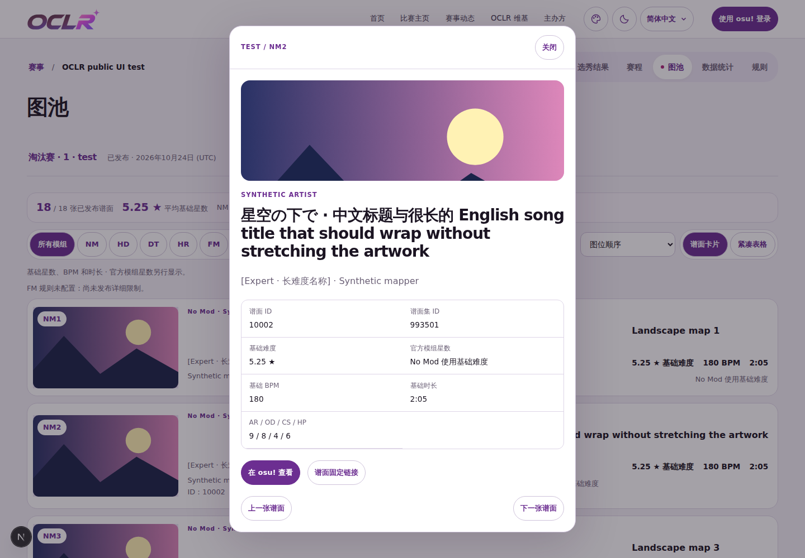  |   |
| Desktop current compact | 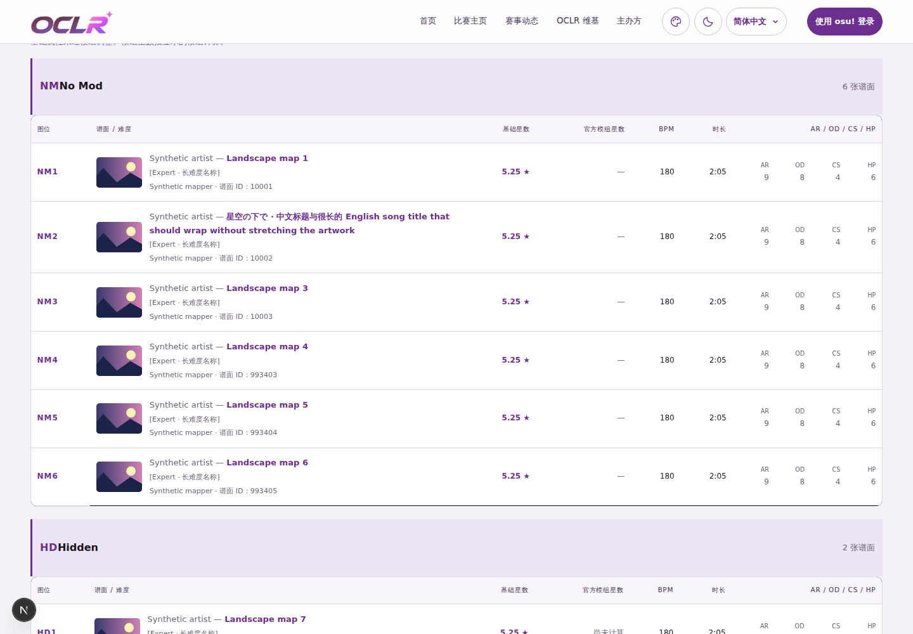 | 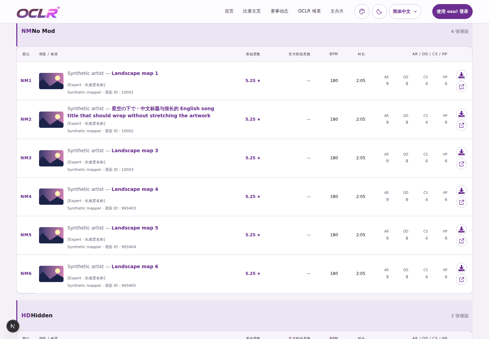 |
| Desktop archive details | 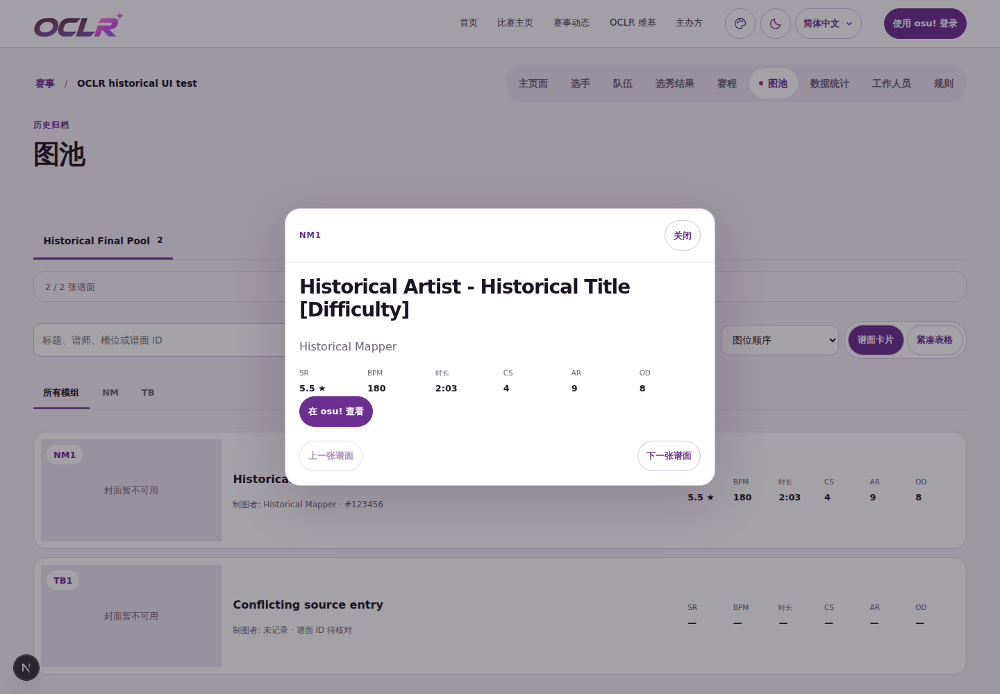  | 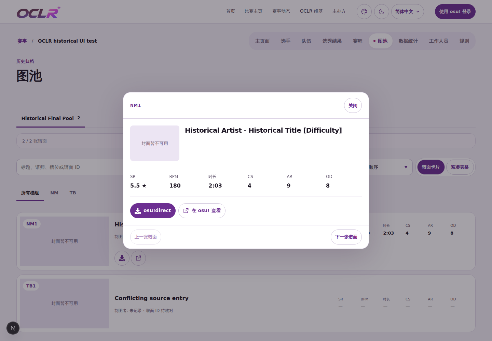  |
| Desktop archive compact | 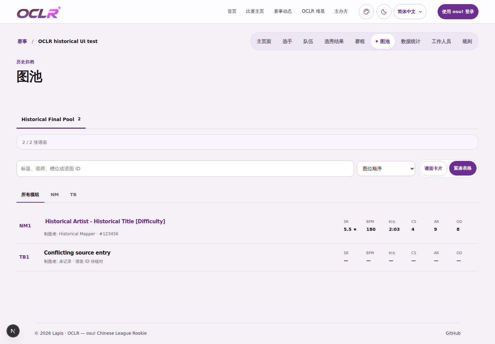 | 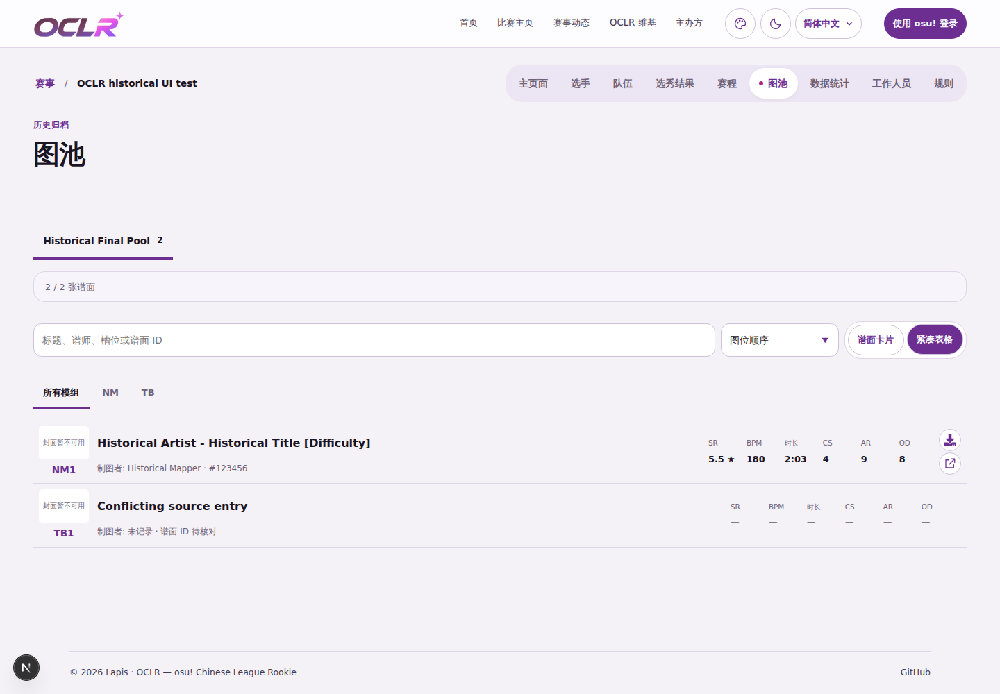 |
| Mobile current details  | 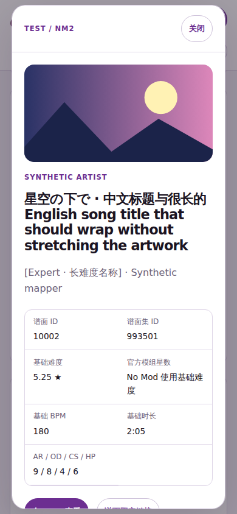   | 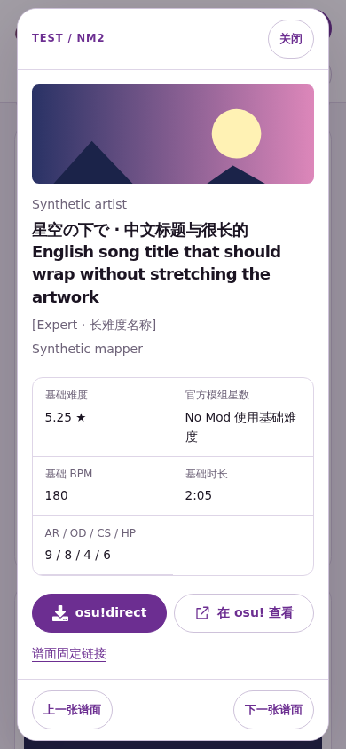   |
| Mobile current compact  | 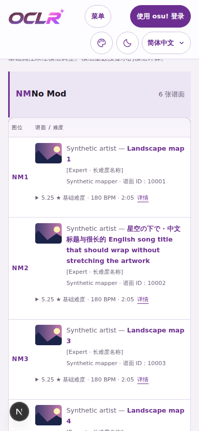  | 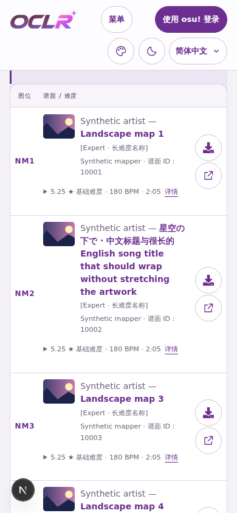  |
| Mobile archive details  | 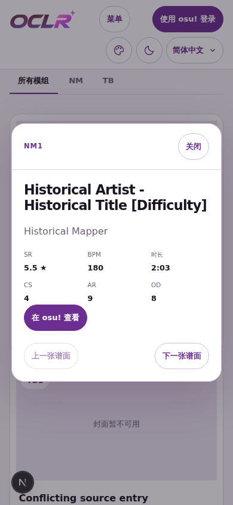   | 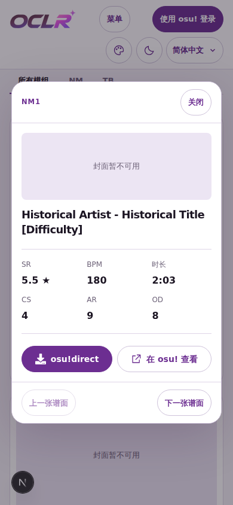   |
| Mobile archive compact  | 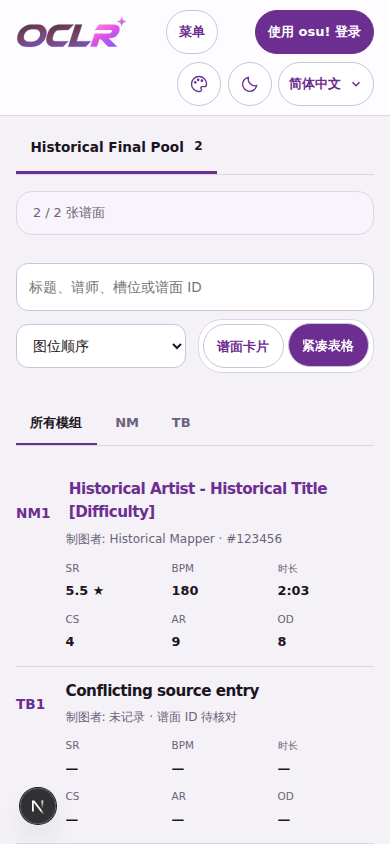  | 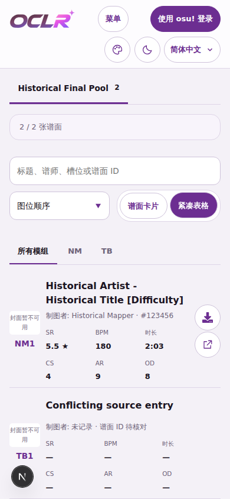  |

## Verification

Validation uses a disposable Linux runtime, Node 24 and isolated loopback
PostgreSQL databases with a separate `test` name segment. No demo or production
database, credentials or services are used. Existing browser regressions are
updated to test compact dialog opening, direct/website targets, next-map target
updates, Escape/focus restoration, the single mod filter, consistent column widths
and stacked action geometry. The historical compact view retains its verified
website action.

Final check results are recorded with the PR. Local preview routes, upstream
adapters, provider copies, seed/capture scripts, test databases, logs and generated
browser artifacts are not part of the feature change. Only the reviewed source,
regression tests, attribution and these comparison screenshots are retained.
