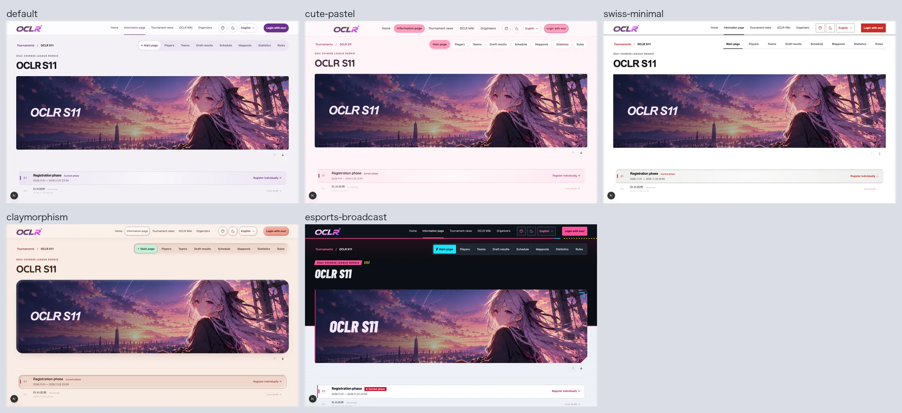
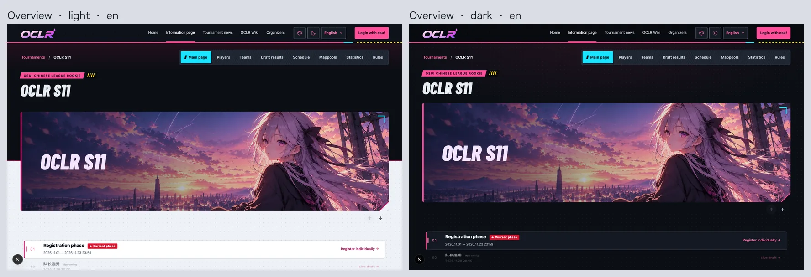
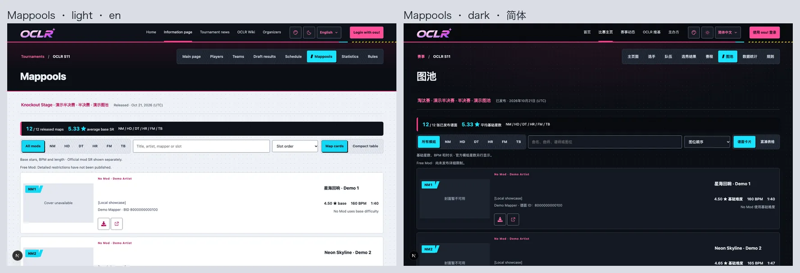
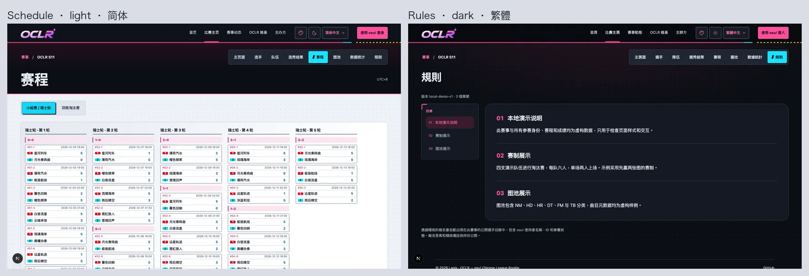
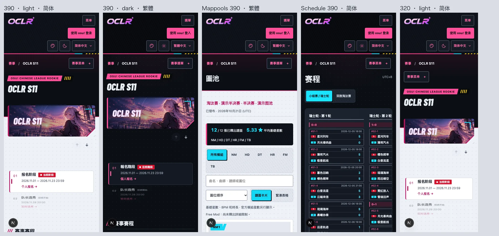
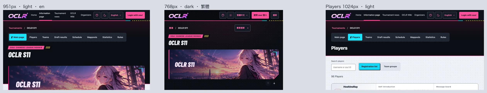
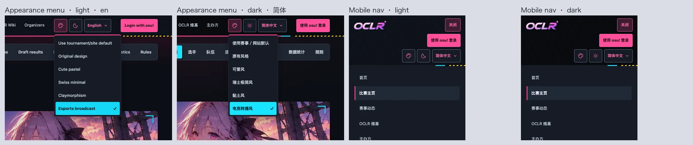
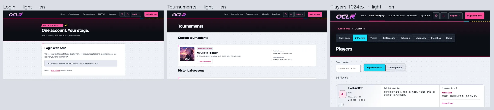
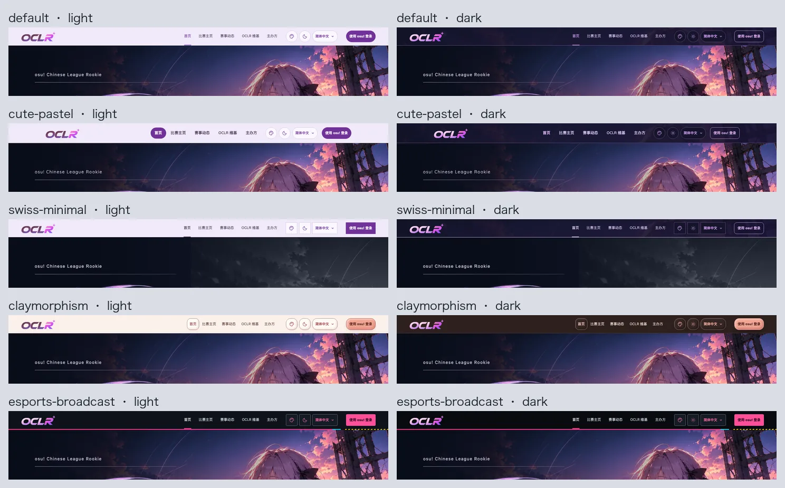
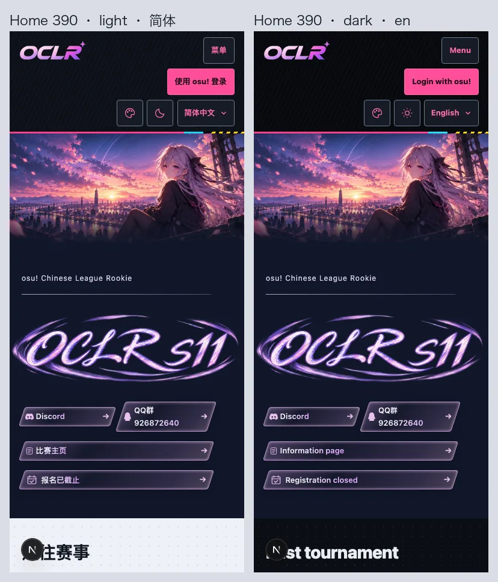

# Issue #235: Esports Broadcast appearance

`esports-broadcast` is a fifth optional appearance next to the original design,
cute-pastel, swiss-minimal and claymorphism. Visitors pick it from the header
menu, global Admins can make it the site default, and edition Admins can make it
a tournament default. Priority, cookie handling, light/dark independence and
OBS/presenter isolation are unchanged.

## Design

An arena broadcast package, following the issue's colour, geometry and type spec.

- **Broadcast bar:** the header is a black strip with fine pinstripes and a 3px
  magenta rule that ends in a cyan segment and yellow/black hazard tape, in both
  brightness modes; the current section is marked by the magenta rule. Menus and
  the mobile navigation drop from the bar with the same dark tokens.
- **Dark stage, light content:** the dark mode is a lit stage throughout
  (`#0b0e14`). The light mode is an independent palette (`#eef1f6`) that keeps a
  dark stage at the top of public pages and the login page: the breadcrumb and
  tournament navigation, the page title and, on the overview, the top half of the
  hero sit on a full-width dark band closed by a magenta rule, while content below
  stays light. This fixes the source's always-dark site without losing the stage.
  The band is a `border-image` outset (no layout change, no horizontal scroll),
  is dropped under forced colours, and is not applied to private workspaces with
  sidebars.
- **Texture:** pages sit on a fine LED dot grid, the dark mode adds a magenta stage
  wash from the top, and selection tracks carry a faint diagonal grain. Panels and
  cards keep solid surfaces, so no text sits on a pattern.
- **Colour roles:** magenta for interaction and primary actions; cyan for data and
  the selected slot (tabs, mod filters, menu choice, map slot plates, scores and
  pool totals). Signal yellow only appears on black (hazard tape, the speed-slash
  tag after page eyebrows), keeping clear of S7's metallic yellow. Live red marks
  the current phase and slot 1 in bracket cards; slot 2 is cyan. None of these
  replace success/warning/danger or mod semantics.
- **Sharpness:** primary buttons cast a hard offset plate (black in light, cyan in
  dark) and press 2px into it; the selected slot has a 2px black offset. Pool
  totals sit on a black scoreboard strip with cyan figures.
- **Slants are decoration only:** the eyebrow plate and slash tag, the three speed
  bars before section titles and the current-tab tick are `pointer-events: none`
  pseudo-elements, as is the slot-plate tail; panel corner brackets are background
  layers; the hero's corner cut and cyan frame mark sit on a decorative layer above
  the art. Button text is never skewed, containers are never clip-pathed, and
  tournament artwork is never recoloured.
- **Type:** event titles use Barlow Condensed ExtraBold Italic, bundled locally
  under SIL OFL 1.1 (one 24 KB Latin woff2 in `public/fonts`; the source's 600
  weight has no use here, so it is not bundled).
  Its Latin-only `unicode-range` leaves Chinese upright on the system sans. Page
  labels and body text keep the system sans at 16px/1.65; scores use tabular
  figures. No remote font requests.
- **Tables:** sit on a solid surface (never on the dot texture); heads echo the bar
  with a magenta underline and flip text/link tokens locally; alternate rows are
  lightly shaded for scanning.
- **States:** disabled is a dashed edge on a raised fill with muted text and no
  plate; selected is a cyan fill with an edge and bold text; focus is a 3px ring
  with a 4px offset; links in running text are underlined. Forced colours drop
  plates and decoration and map selection to `Highlight`/`HighlightText` (opting
  out of the text backplate that would hide the label); reduced motion removes
  transitions and the pressed nudge. Nothing blinks or animates continuously.
- **Contrast (computed):** normal text is at least 4.5:1 on background, surface,
  raised, tint and selected in both modes (lowest 4.84 light, 5.03 dark); control
  borders and focus are at least 3:1 (lowest 3.51); text on the bar and
  scoreboard is at least 6.09:1; white on live red is 5.33:1.
- **Homepage header:** becomes the broadcast bar only when this appearance is
  selected; the other appearances keep the S11 home palette from `home.css`.

## Issue requirements checklist

| Requirement (#235)                                       | How it is met                                                                                                               |
| -------------------------------------------------------- | --------------------------------------------------------------------------------------------------------------------------- |
| Magenta primary interaction                              | Primary buttons, links, focus ring, header navigation underline, eyebrow plates                                             |
| Cyan numbers / slots                                     | Scores, pool totals, map slot plates, selected tab/filter/menu item, segmented progress                                     |
| Limited diagonal decoration; data tables upright         | Slants only on small decorative layers; tables upright on a solid surface with tabular figures                              |
| Dark stage                                               | Dark mode throughout; dark stage band at the top of light-mode public pages                                                 |
| Magenta navigation underline                             | 3px magenta underline on the current header link; magenta rule under the bar                                                |
| Diagonal label backgrounds                               | Skewed magenta eyebrow plate plus black slash tag (pseudo-elements)                                                         |
| Clipped-corner hero decoration                           | Corner cut and cyan frame mark on a `pointer-events: none` layer above the banner; no `clip-path`                           |
| Segmented progress, cyan slots                           | `progress` drawn as cyan segments; cyan slot plates                                                                         |
| Panels 6px, controls 4px                                 | `--radius-panel: 6px`, `--button-radius: 4px` (inputs, buttons, tabs)                                                       |
| Slants only on non-interactive pseudo-elements           | Eyebrow plate/tag, section bars, current-tab tick, slot tail, hero corner layer                                             |
| No skewed button text, no clipped containers             | No `transform` on controls except the 2px press; no `clip-path` anywhere                                                    |
| Barlow Condensed italic for English event titles only    | Local OFL woff2, Latin `unicode-range`, edition titles only; Chinese stays upright                                          |
| Body: system sans 16px/1.65; scores tabular-nums         | `.themed-site` line-height 1.65 on the existing sans stack; tabular figures on every score display                          |
| Not OBS/presenter; not S7 metallic yellow or S10 sky art | OBS overlay pixel-identical; flat signal yellow only on black; artwork untouched                                            |
| Fix: whole site dark                                     | Independent light palette with only a top stage band                                                                        |
| Fix: whole-button skew                                   | Buttons upright; sharpness comes from hard offset plates                                                                    |
| Fix: hero clip-path                                      | Replaced by a decorative corner layer                                                                                       |
| Fix: condensed body text                                 | Condensed face limited to Latin event titles                                                                                |
| Keep form focus and menu visibility                      | 3px focus ring with 4px offset on all controls; menus drop from the bar with cyan checked item; Highlight in forced colours |

All screenshots use the local demo seed (`npm run db:seed:dev`); names, dates and
scores are demo data.

## Local verification (2026-10-24)

- `npm run lint` and `npm run typecheck`: no errors.
- `npm test` on the isolated `oclr_esports_test` database after merging the latest
  `main` (889304d, with Manga halftone's 0039, Glassmorphism's 0040 and the
  compact mobile header from #295): 968 passed, 1 skipped (the same skip as on
  `main`), including the new 0041 migration upgrade test. The compact mobile header
  checks (two rows, 44px targets, unobstructed, in viewport) pass for this
  appearance at 320–430px in all locales and both themes.
- `npm run build` passed; `npm audit --omit=dev` found 0 vulnerabilities.
- `npm run i18n:extract` and `npm run test:i18n` passed.
- Header navigation at 951px is exactly as wide as the default appearance in all
  three locales (302px zh-Hans/zh-Hant, 389px en); header menus stay inside the
  viewport at 320/390/1440px. Every visible header control stays unobstructed and
  on screen at the header-overlap widths, including the new 1100/1101px pair, in
  all three locales and both themes.
- Dev-server screenshots at 320/390/768/951/1024/1440px across the three locales
  and both themes showed no horizontal overflow and no script errors.
- The OBS draft overlay renders pixel-identically to the default appearance in
  light and dark.
- Axe (WCAG 2 A/AA) on ten public pages in both themes at 1440px and 390px: no
  violations from this appearance. One `scrollable-region-focusable` finding on
  the players message board is pre-existing in every appearance.
- Forced-colours and reduced-motion emulation checked on mappools; a temporary
  primary/secondary/disabled button set was checked for plates, keyboard focus and
  both themes in the dev preview.
- Playwright e2e was **not** run locally (Admin/Player/Captain pages need a test
  session); the updated appearance, site-settings, header-overlap and
  header-branding specs run in CI, which is authoritative.

## Not covered here

- Organizer confirmation of the style direction and name.
- Organizer review of the new Chinese label 电竞转播风 / 電競轉播風.
- Visual review of signed-in Admin, Player and Captain pages (covered by CI Axe
  and layout specs only).
