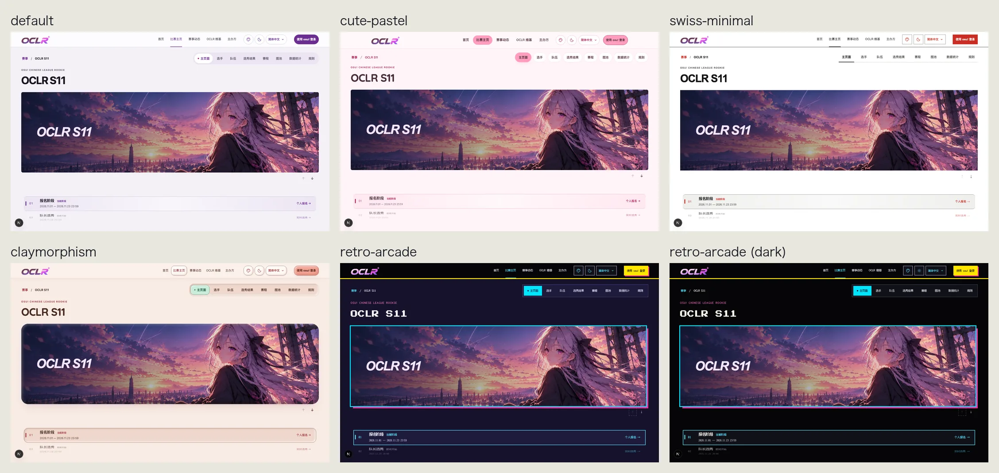
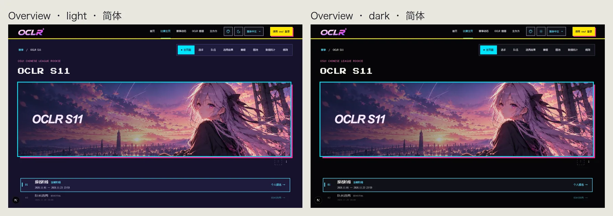
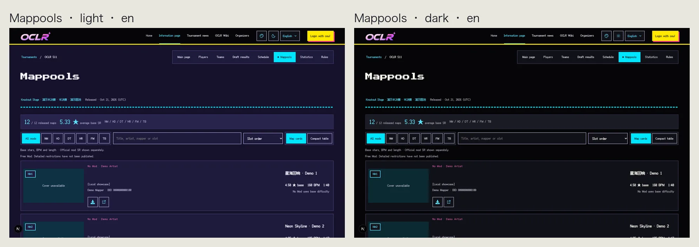
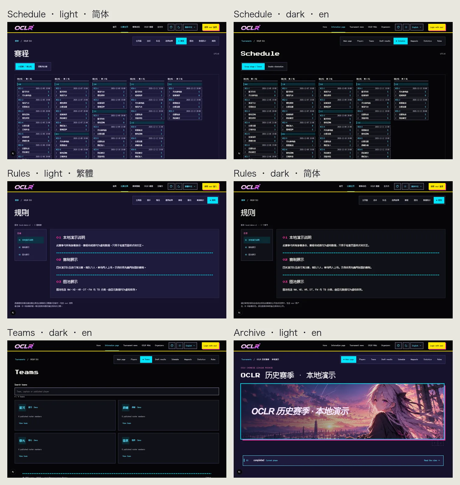
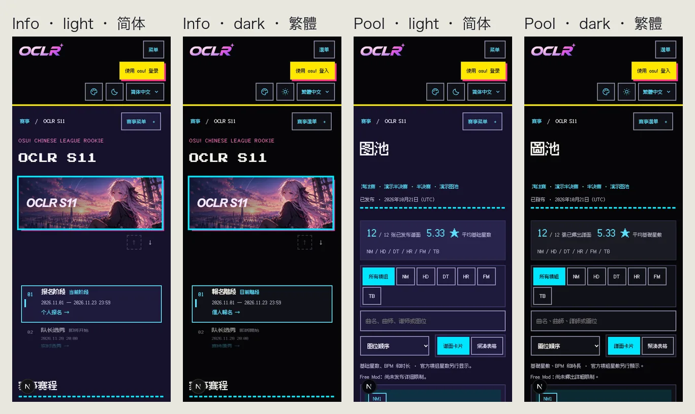
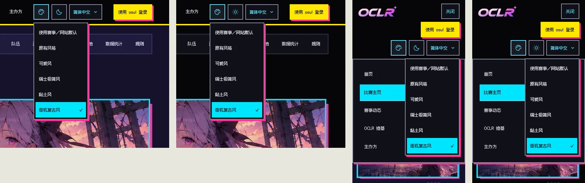
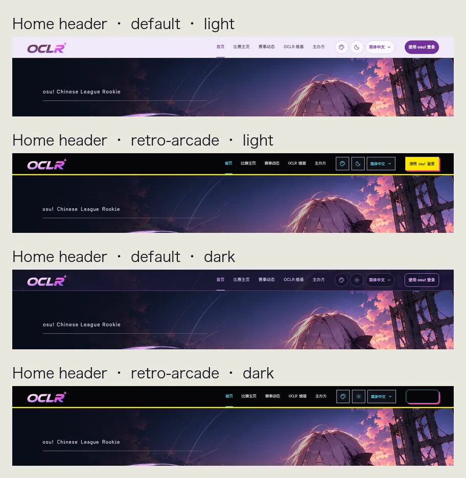

# Issue #236: Retro arcade appearance

`retro-arcade` is a fifth optional appearance next to the original design,
cute-pastel, swiss-minimal and claymorphism. Visitors pick it from the header
menu, global Admins can make it the site default, and edition Admins can make it
a tournament default. Priority, cookie handling, light/dark independence and
OBS/presenter isolation are unchanged.

## Design

- **Dark cabinet in both modes:** dark mode is black (`#050508`); light mode is
  a step brighter deep indigo (`#15122b`) instead of a paper variant, after
  contributor review asked for a black/deep-dark background throughout. The
  header is a black marquee with a 4px yellow rule in both modes. This departs
  from the issue's literal "add a light variant" and needs organizer sign-off.
- **Yellow / cyan / magenta, one job each:** yellow fills the primary action and
  draws the marquee rule; cyan is the selection cursor, links, keyboard focus,
  the 4px hero frame and the neon dividers; magenta is decoration only (hard
  shadows, small labels). Success, warning and danger keep separate green,
  orange and red, so interaction never looks like an error.
- **Square, 4px frames, hard shadows, no stacking:** everything is 0px, including
  avatars and indicator dots. Primary keys: 2px edge plus a 4px magenta hard
  shadow, and the key sinks into the shadow when pressed. Hero banner: 4px cyan
  frame plus a magenta hard shadow. Popovers and dialogs: 2px edge plus a hard
  shadow. Panels and cards use 2px edges; table rows stay thin.
- **Neon segments:** section heading rules, rules-chapter separators, the mappool
  release heading, the homepage archive heading and the footer edge become 4px
  segmented cyan lines; progress is a segmented power bar.
- **Pixel type everywhere, including Chinese:** page h1 and section h2 use
  Press Start 2P for Latin and Fusion Pixel 12px for Chinese. All other text
  (navigation, buttons, labels, body copy, tables, form fields, beatmap/team/news
  titles) uses Fusion Pixel. Small text snaps to the native 12px, body copy is
  16px and headings are 48/36/24px. Contributor review asked for pixel type
  throughout; this goes beyond the issue's original "keep body text, Chinese and
  beatmap titles readable" limit and needs organizer sign-off.
- **Fonts and licences:** both are SIL OFL 1.1 and shipped unmodified in
  `public/fonts/`. Press Start 2P has a Reserved Font Name, so it is not subset
  (118 KB). Fusion Pixel ships one file per locale (about 0.7 MB each, with the
  Ark Pixel, Cubic 11 and Galmuri licences); a page loads only its locale's file.
  No remote font requests.
- **Scanlines only in decorative bands:** faint, static scanlines appear in empty
  states and the footer band; the style still reads with them off. No flashing or
  looping animation. Reduced motion removes the press offset and transitions;
  `forced-colors` removes shadows, segments and scanlines.
- **Homepage header:** the same black marquee when retro-arcade is selected; the
  other appearances keep the S11 home palette.

All screenshots use the local demo seed (`npm run db:seed:dev`); names, dates and
scores are demo data.

## Contrast

Normal text (foreground, muted, secondary, links, labels, success, warning,
danger) is ≥5.7:1 in light (indigo) and ≥5.9:1 in dark on background, surface,
raised and tint. Control borders are ≥4.4:1 and focus rings ≥8.8:1 on every
surface. Text on the primary key is 14.4:1 / 16.1:1; on the cursor block
11.8:1 / 13.2:1.

## Local verification (2026-10-24)

- `npm run lint`, `npm run typecheck`: no errors.
- `npm test` on the isolated `oclr_arcade_test` database after syncing with
  upstream main (`5f3e9d9`, which added Manga halftone 0039, Glassmorphism 0040
  and Esports broadcast 0041): 970 passed, 1 skipped, including the new 0042
  migration upgrade test.
- `npm run build` passed; `npm audit --omit=dev` found 0 vulnerabilities.
- `npm run i18n:extract` and `npm run test:i18n` passed.
- Press Start 2P and the locale's Fusion Pixel file load from `/fonts/` (HTTP 200); no external font requests.
- Dev-server checks: 13 public pages at 320/390/768/951/1024/1440px in both
  themes showed no horizontal overflow and no script errors. At 951px the header
  nav is no wider than the default (zh-Hans 272px vs 302px, en 385px vs 389px). The
  appearance menu stays inside the viewport at 320px and 1440px. Header buttons
  and links are neither covered nor off-screen at the header-overlap widths
  (320–1440px, including 1100/1101px) in all three locales and both themes.
- Playwright e2e was not run locally; the updated appearance, site-settings,
  header-overlap and header-branding specs run in CI, which is authoritative.

## Not covered here

- Organizer confirmation of the style direction and name.
- Organizer review of the new Chinese label 街机复古风 / 街機復古風.
- Organizer sign-off on two contributor-review decisions that go beyond the
  issue text: light mode is a deep-indigo dark variant rather than a light one,
  and all text (including body copy, tables and beatmap titles) uses pixel type.
- Admin, Player and Captain pages behind osu! OAuth were not opened locally
  (no OAuth app configured); they share the same MainSheet tokens and selectors.
