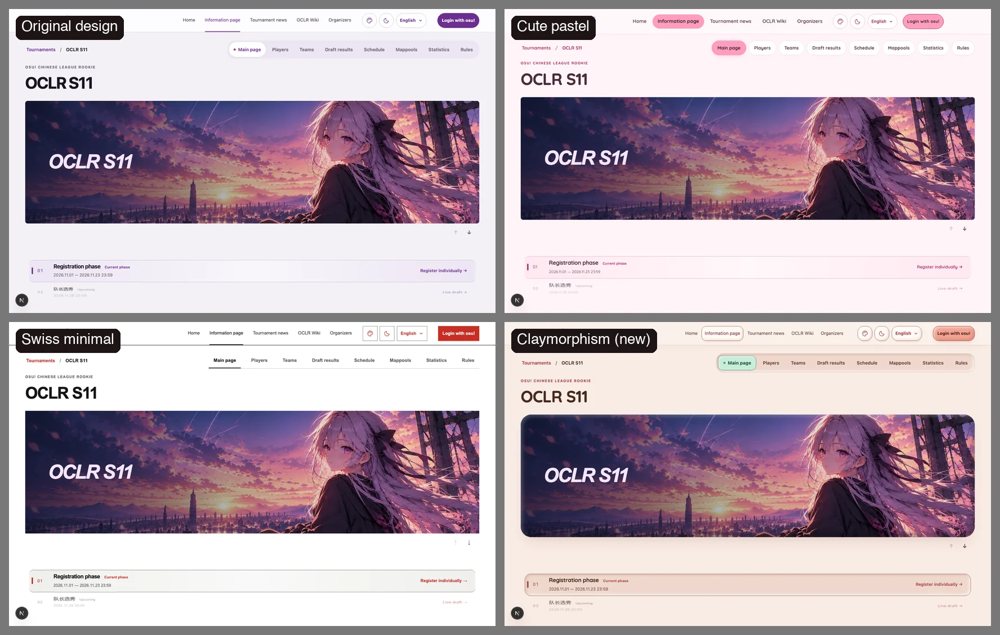
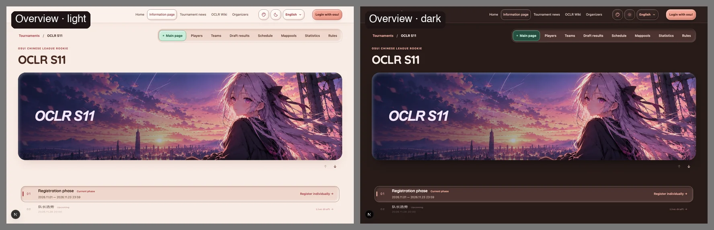
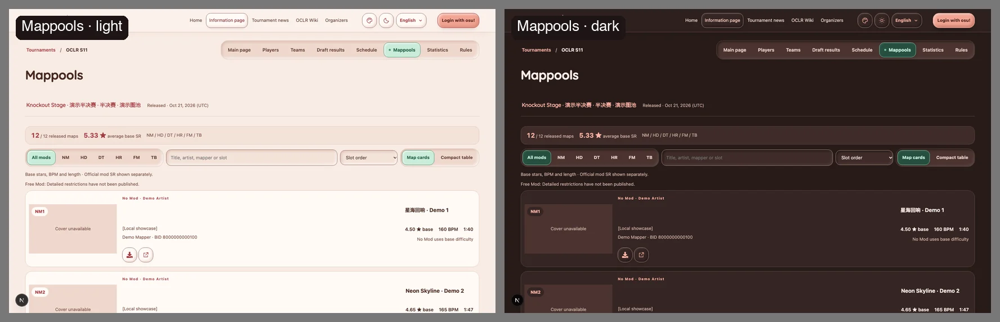
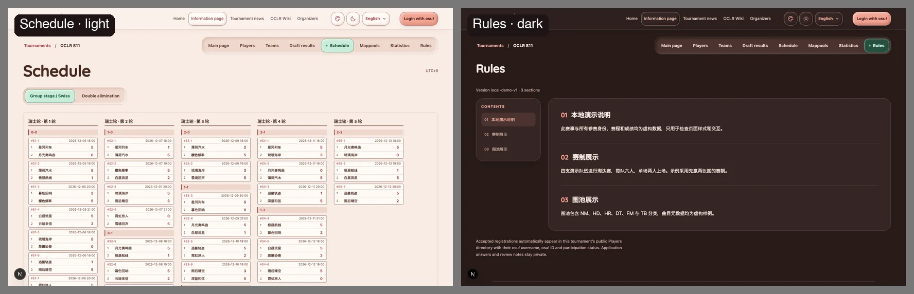
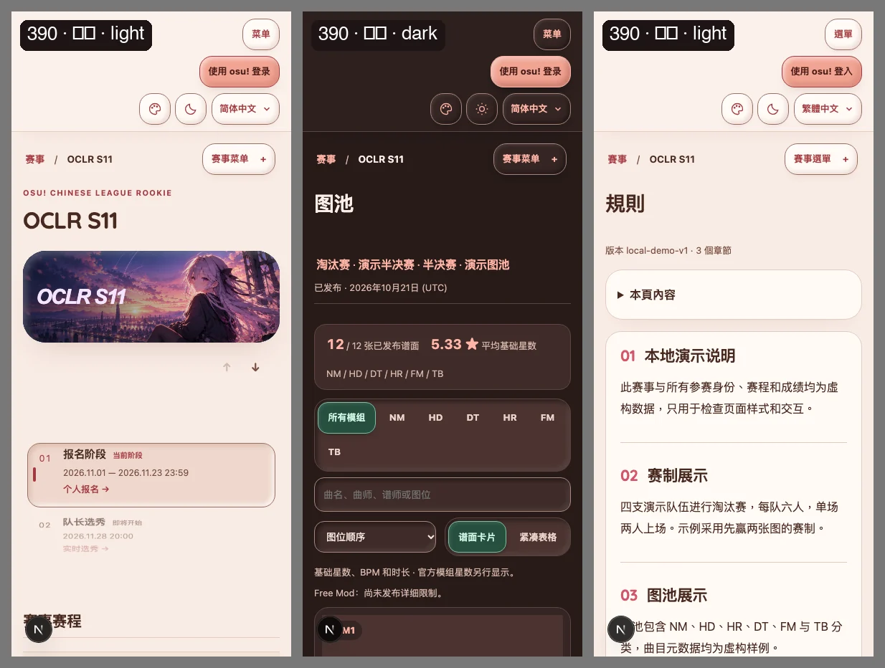
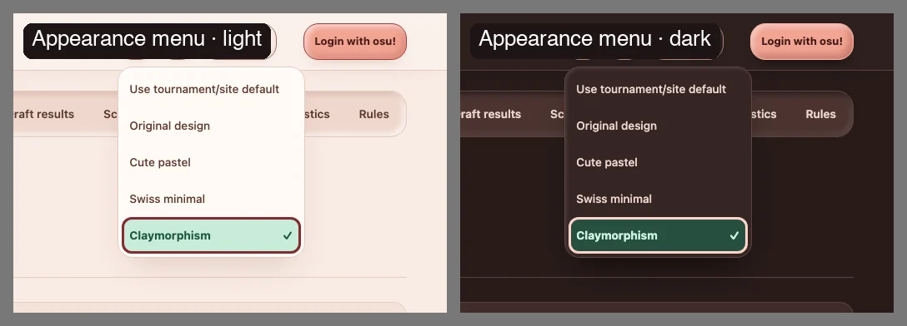
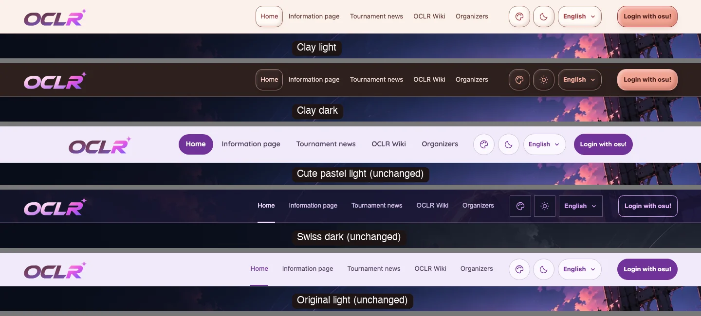
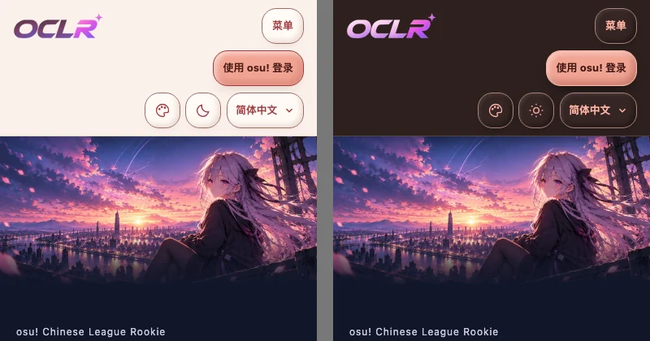

# Issue #237: Claymorphism appearance

`claymorphism` is a fourth optional appearance next to the original design,
cute-pastel and swiss-minimal. Visitors pick it from the header menu, global
Admins can make it the site default, and edition Admins can make it a tournament
default. Priority, cookie handling, light/dark independence and OBS/presenter
isolation are unchanged.

## Design

- **Palette:** warm putty surfaces (`#f8ebe4` light, `#271b19` dark), a terracotta
  accent, a coral primary button and a small-area mint selected state. The
  organizer's candidate palette was almost identical to cute-pastel, so it was
  warmed to keep the two preferences visibly distinct.
- **Material:** raised for the hero, information banner, real buttons and popovers;
  pressed-in for inputs, progress, selection tracks and the stage wheel's current
  row; flat for tables, map/match cards and repeated rows.
- **States without shadows:** disabled is a dashed edge plus the existing opacity,
  selected/pressed is mint with a mint border and bold text, and focus is a 3px
  solid ring with a 4px offset. `forced-colors` removes every shadow.
- **Dark:** depth comes from darker drops and a faint rim light, not inverted pinks.
- **Homepage header:** follows clay only when claymorphism is selected; the other
  appearances keep the S11 home palette from `home.css`.
- **Type:** headings reuse the bundled Quicksand; body text stays on the system
  stack for Chinese readability. No remote font requests.

All screenshots use the local demo seed (`npm run db:seed:dev`); names, dates and
scores are demo data.

## Local verification (2026-10-24)

- `npm run lint` and `npm run typecheck`: no errors (the only lint warning is from
  an untracked local tool file outside the change).
- `npm test` on the isolated `oclr_test` database: 930 passed, 1 skipped
  (the same skip as on `main`), including the new 0038 migration upgrade test.
- `npm run build` passed; `npm audit --omit=dev` found 0 vulnerabilities.
- `npm run i18n:extract` and `npm run test:i18n` passed.
- Desktop/mobile Playwright for the appearance, site-settings, header-overlap
  and header-branding specs passed (100/100) after the 951px header fix. A later
  full-suite run and a homepage-header rerun were stopped partway with no failures
  (109/438 and 53/124). The `firefox-header` project could not launch in the local
  sandbox. CI is authoritative for the complete suite.
- Dev-server screenshots at 320/390/768/951/1440px in all three locales and both
  themes showed no horizontal overflow and no script errors.

## Not covered here

- Organizer confirmation of the style direction and name.
- Organizer review of the new Chinese label 黏土风 / 黏土風.
