# Issue #238: Manga halftone appearance

`manga-halftone` is a fifth optional appearance next to the original design,
cute-pastel, swiss-minimal and claymorphism. Visitors pick it from the header
menu, global Admins can make it the site default, and edition Admins can make it
a tournament default. Priority, cookie handling, light/dark independence and
OBS/presenter isolation are unchanged.

## Design

Follows the issue's spec for style F: a hierarchy of ink lines, English comic
titles, speech bubbles, halftone around the hero and sparse speed lines, with the
match content kept first.

- **Palette:** the organizer's candidate tokens: white paper `#fbfaf8`, ink
  `#171515`, accent `#b42366` (dark: `#171418` paper, `#ff7eb9` primary). The
  source's screentone pink `#ff4f9a` is decoration only, never a state colour.
- **Ink-line hierarchy, 2px square corners:** 3px for the hero banner and large
  sections (panels, rules, edition cards, dialogs); 2px for buttons, inputs,
  menus, selection tracks and repeated cards; 1px for table rows. Table headers
  become a black caption band. The source's heavy frame around every value is
  not carried over.
- **Type:** Bangers (bundled, SIL OFL 1.1) for English display titles, page
  eyebrows and map slot labels. Its `unicode-range` is Latin only, so Chinese
  glyphs always fall back to the system sans at 700; weight synthesis is off
  because Bangers has a single weight. Glyph coverage was checked for Latin,
  digits and common punctuation (★ falls back). No remote font requests.
- **Koma (panel) layout:** the edition overview reads as a manga page. The
  title, artwork and stage wheel are three ink panels split by narrow gutters;
  the title panel has a cut corner, and its speech bubble breaks the frame.
- **Balloons:** speech bubbles for page eyebrows and status notices, a shout
  burst for the current-phase label (white text on a solid pill, spikes as an
  extra layer), thought balloons for empty states and a narration box for the
  rules contents label.
- **Artist's tools, limited area:** size-graded halftone in the title panel's
  cut corner (large dots at the corner, small dots fading toward the title,
  hidden below 768px, measured not to overlap the title at 768/1024/1440px,
  never over the artwork); line-tone hatching as the shade of tournament cards,
  kept under a paper layer so it never reaches the content; one speed-line strip
  under page titles; a tapered G-pen stroke under section headings; a pen nib
  with a drop of ink on the footer rule; screentone progress tracks. None sit
  behind text; all decorative layers use `pointer-events: none`.
- **No rotation:** the source's `rotate(-2deg)` buttons are dropped. Primary
  buttons are ink plates with a 3px pink print offset that closes to 1px when
  pressed (`transform` only, no layout shift).
- **States without shadows:** selected tabs, the current header section, the
  current rules chapter and checked menu items are inverted ink cells with bold
  text; disabled is dashed plus the existing opacity; focus is a 3px ring with a
  4px offset. `forced-colors` removes shadows and decorations and underlines the
  selected items.
- **Dark:** every ink line is warm white `#e9dccb`; no pure-white page frame.
- **Homepage header:** follows manga only when manga-halftone is selected (like
  claymorphism); the other appearances keep the S11 home palette from `home.css`.

Contrast (computed): text tokens are at least 5.0:1 and ink lines/focus at least
5.0:1 on background, surface, raised, tint and selection in both modes.

All screenshots use the local demo seed (`npm run db:seed:dev`); names, dates and
scores are demo data.

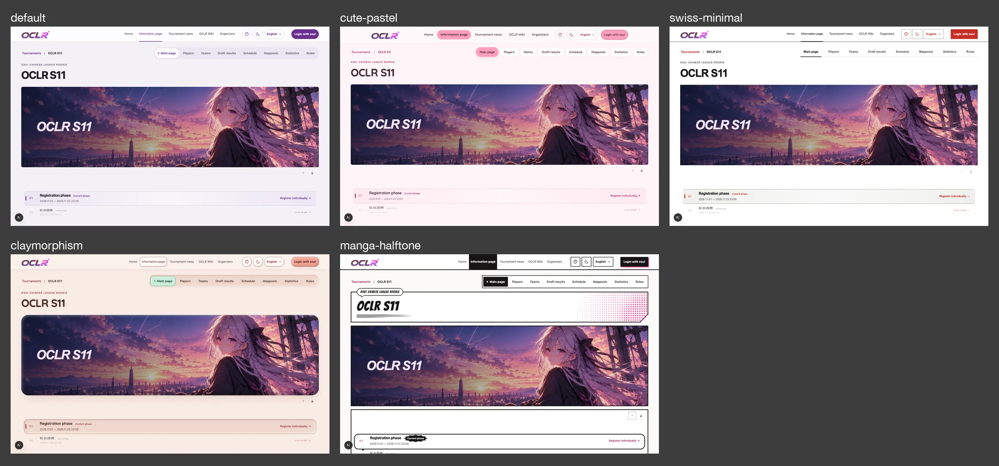

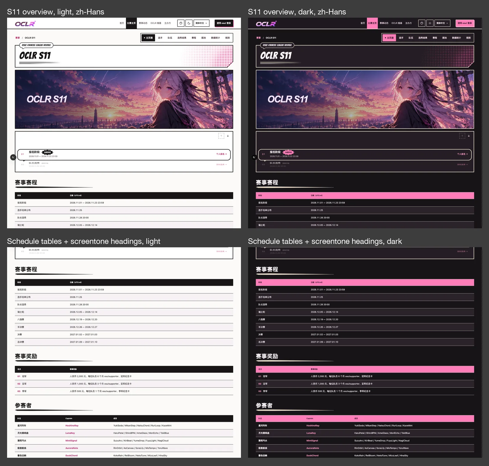

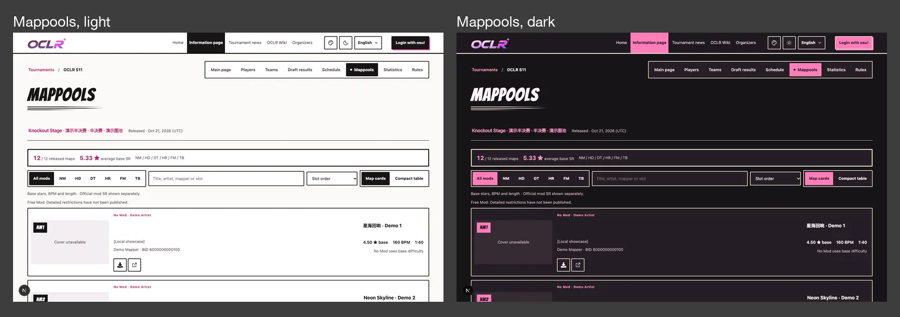

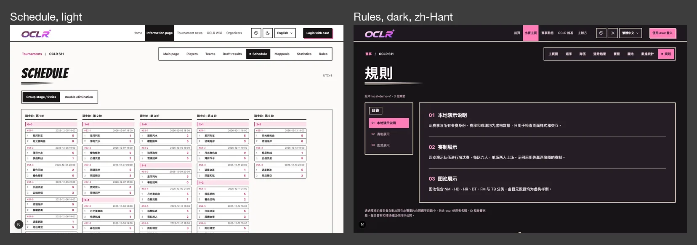

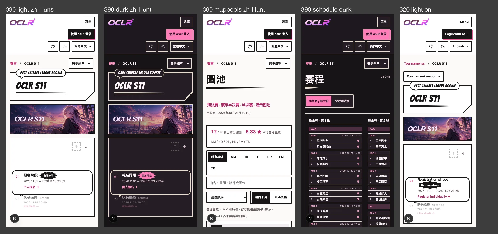

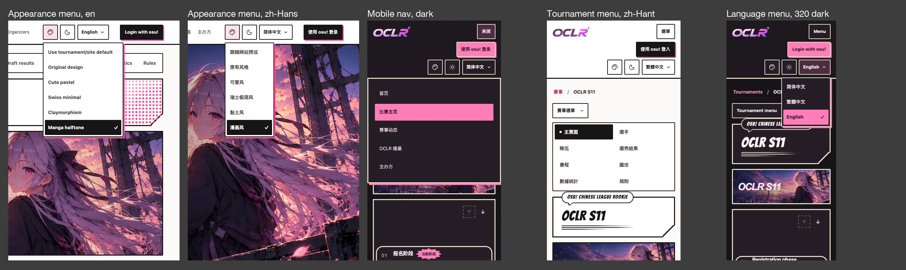

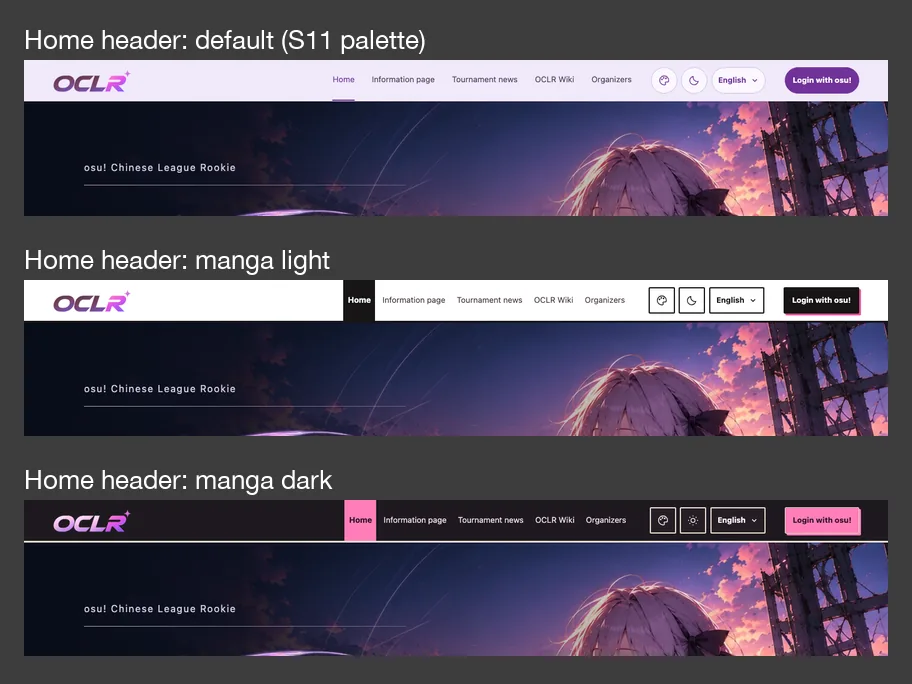

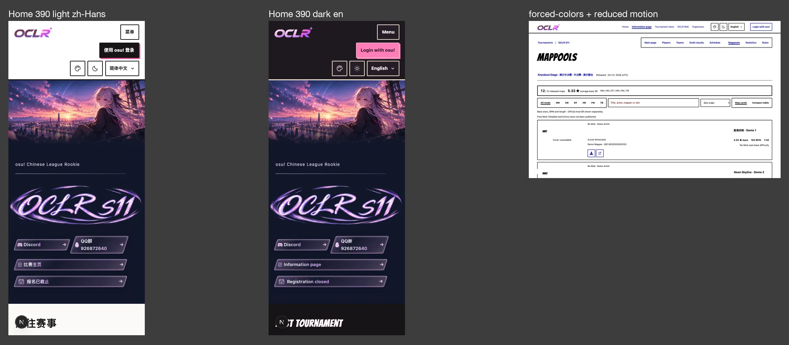

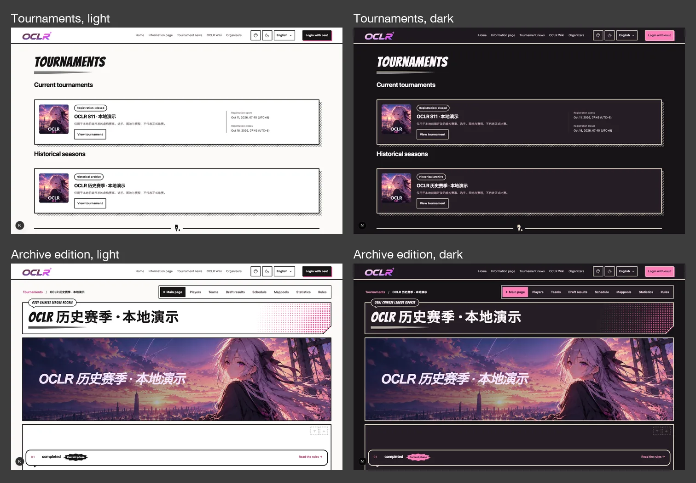

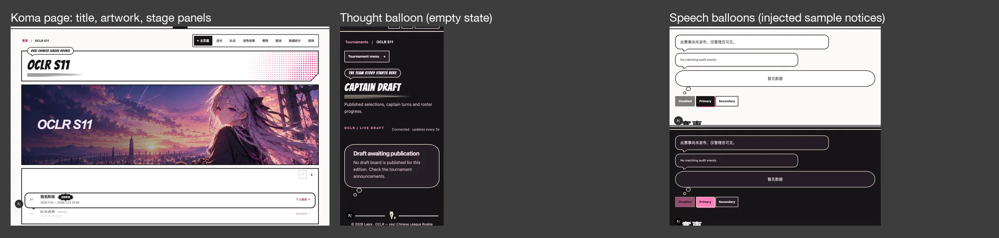

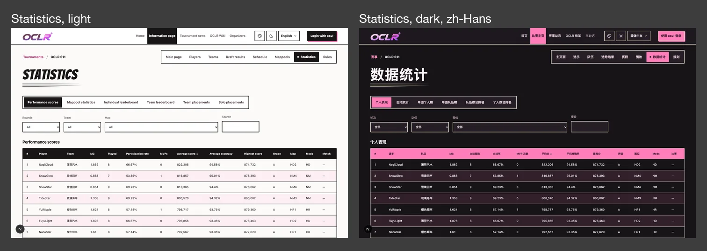

## Local verification (2026-10-24)

- `npm run lint` and `npm run typecheck`: no errors.
- `npm test` on an isolated test database: 949 passed, 1 skipped (the same skip
  as on `main`), including the new 0039 migration upgrade test.
- `npm run build` passed; `npm audit --omit=dev` found 0 vulnerabilities.
- `npm run i18n:extract` and `npm run test:i18n` passed.
- Dev-server screenshots at 320/390/768/951/1024/1440px across all three locales
  and both themes showed no horizontal overflow and no script errors. At 951px
  the header navigation is no wider than the default's. Header, language and
  appearance menus and the mobile navigation stay inside the viewport. Bangers is
  requested only from `/fonts/bangers-latin-400.woff2`; no other font or
  third-party request was made.
- Decorative pseudo-elements report `pointer-events: none`; keyboard focus shows
  the 3px ring with a 4px offset.
- Playwright e2e was not run locally; the appearance, site-settings,
  header-overlap and header-branding specs were extended for `manga-halftone`.
  CI is authoritative.

## Not covered here

- Organizer confirmation of the style direction and name.
- Organizer review of the new Chinese label 漫画风 / 漫畫風.
- Admin, Player and Captain pages behind osu! sign-in (no local OAuth); they use
  the same shared tokens and component rules as the public pages.
