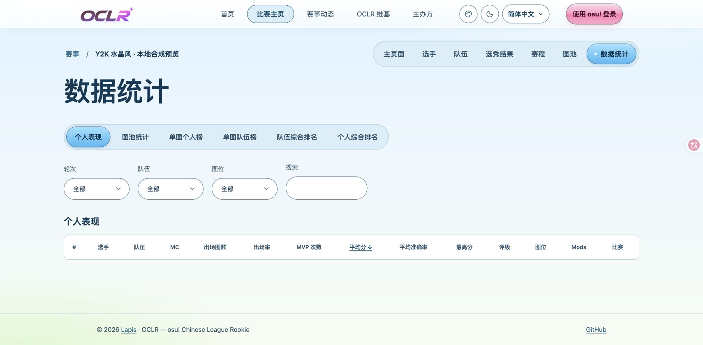
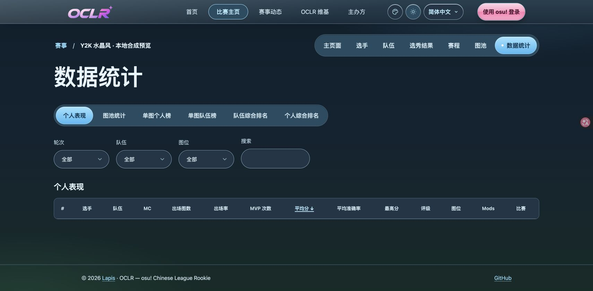

# Issue #239: Frutiger Aero appearance

`frutiger-aero` is the ninth registered appearance, after the original design,
cute-pastel, swiss-minimal, claymorphism, manga-halftone, glassmorphism,
esports-broadcast and retro-arcade. Visitors choose it from the header menu,
global Admins can make it the site default, and edition Admins can set it as a
tournament default. Priority, cookie handling, SSR, light/dark independence and
OBS/presenter isolation are unchanged; no edition is opted into the theme
automatically.

## Design

- **Material:** a fixed sky-blue-to-mint gradient behind the page, a glossy
  header, 20px panels, capsule controls at least 44px tall, and a glossy pink
  primary action with dark text. Progress is an explicit mint capsule. Short map
  slot codes are 52px blue circles (44px on mobile); imported or archive labels
  that are longer grow into a capsule and wrap instead of clipping.
- **Flat data:** tables, rules, repeated match/map/player cards and every table
  row use a plain surface with a 1px border. Only the header, panels, the edition
  heading, the primary action and progress carry a highlight. Global navigation
  items are 44px capsules with 16–18.4px side padding; sortable table headers,
  `.map-open-button` and `.statistics-player` are flat text triggers with a 44px
  hit area, not glossy CTAs. The English/logged-in header collapses to the real
  menu at 951–1100px, keeps 16px capsules with tighter gaps at 1101–1360px, and
  returns to 18.4px padding above that, so text is never squeezed or overlapped.
- **Full-bleed footer:** the footer is a transparent full-width band whose inner
  padding aligns with the 1240px content grid, so no bounded rectangle or side
  gaps remain.
- **Select affordance:** the native chevron is replaced by one 12×8 inline SVG
  arrow inset 1rem from the right, with 2.75rem inline-end padding so text never
  sits under it; `forced-colors` restores the native control instead of stacking
  a second arrow.
- **No blur, no overlay bubbles:** the only background decoration is a fixed
  `pointer-events: none` gradient. The edition heading highlight is a background
  gradient, so it cannot cover text, artwork or the focus ring.
- **Contrast:** normal and muted text ≥4.5:1; control borders, focus and the
  mint progress fill ≥3:1, measured on background, surface, raised, tint and
  selected states. The blue selected chip uses the dark label `#04334d`; the
  pink action uses `#4a0d28`.
- **States:** selected is a blue filled capsule with bold text, hover only
  changes the fill, pressed uses an inset shadow, disabled is a dashed edge plus
  the existing opacity, and focus is a 3px ring with a 4px offset. Background
  colour is deliberately not transitioned, so no intermediate frame loses
  contrast. Destructive and role-revocation actions keep the danger colour and
  their own hover/pressed fills; semantic `status-*` and `registration-state`
  badges keep the success/warning/danger colours from `workspace.css`.
- **Fallbacks:** `forced-colors` hides the sky, removes decorative gradients and
  shadows, maps surfaces to Canvas, buttons to ButtonFace and focus to
  Highlight. `prefers-reduced-motion` removes transitions. There is no
  `backdrop-filter`, so no reduced-transparency branch is needed.
- **Type:** the existing system sans stack. The source's Varela Round is not
  bundled because its licence and Chinese coverage were not verified; no Google
  Fonts or remote font request is made. The Chinese labels `Y2K 水晶风` /
  `Y2K 水晶風` await organizer review.

Source material and the earlier offline specimen remain under
[appearance-backlog/frutiger-aero](../../design/appearance-backlog/frutiger-aero/DESIGN.md).

## Registration

- `src/lib/preferences.ts` — whitelist entry.
- `src/i18n/appearance.ts` and `messages/{en,zh-Hans,zh-Hant}.json` — labels.
- `src/app/layout.tsx` — imports `frutiger-theme.css`.
- `src/app/frutiger-theme.css` — scoped to
  `html[data-appearance="frutiger-aero"] .themed-site`.
- `src/db/schema.ts` and `drizzle/0044_frutiger_aero_appearance.sql` — widen the
  site setting and audit CHECK constraints, preserving existing values and
  history and still rejecting unknown values.
- `src/lib/extended-read-contracts.json` and `docs/read-api.openapi.json` —
  regenerated appearance enums.

## Checks performed by this implementation session

- `npm run check` — ESLint and TypeScript passed before the visual-review
  refinements and the focused e2e spec were added; Codex reruns it for the final
  tree.
- `npx vitest run tests/unit/appearance.test.ts tests/unit/i18n.test.ts tests/unit/read-api-dx.test.ts` —
  17 tests passed, including the new whitelist value and contract drift check.
- Targeted `0044` migration upgrade test on the isolated temporary database —
  passed: the design is rejected before `0044`, accepted after it, and the
  existing site setting and audit history are preserved while `unknown` is still
  rejected.
- `tests/e2e/frutiger-appearance.spec.ts` — added focused browser coverage for
  adaptive long slot labels, reduced motion, no background-colour transition,
  semantic status/destructive colours and forced-colour mapping, plus
  real-component checks for navigation capsule geometry, the full-bleed footer,
  flat sortable headers and map titles, and select-chevron spacing (including
  the forced-colours native fallback). A logged-in English header test covers
  951/1024/1100px collapsed navigation and the 1101px desktop boundary.
  **Not run by this session.**

## Codex verification and local review checkpoint (2026-10-25)

The user reviewed the local preview and authorized opening a PR after the
requested visual corrections. This record does not claim merge, issue closure
or deployment. The issue claim identifies
himmiv / Codex coordination and DeepSeek Harness V4.1-Flash 1017 implementation.

- `npm ci --ignore-scripts` installed the locked dependencies for this worktree.
- All unit/integration files were exercised: initial full run was 1087 passed,
  7 failed and 1 pre-existing skipped. Six failures came from overlapping fixture
  truncation with the delegated session; the backup test lacked the matching
  PostgreSQL client in PATH. After ending the overlap and supplying the bundled
  PostgreSQL 17 client, the two failed files passed all 18 tests. Aggregate:
  **149 files, 1094 passed, 1 skipped**. No business logic was changed to hide
  those environment failures.
- Migration `0044` was applied to dedicated temporary test, browser and preview
  databases on a separate loopback-only PostgreSQL instance. Fresh/upgrade,
  existing setting/history preservation and unknown-value rejection passed.
- Production build passed again after the visual-review fixes; final ESLint
  passed. TypeScript is checked by the production build.
- i18n extraction and its tests passed; generated read-contract/OpenAPI drift
  checks passed.
- Official npm production dependency audit: **0 vulnerabilities**. The configured
  mirror does not expose the audit endpoint, so the check used registry.npmjs.org.
- Six desktop/mobile settings and inheritance scenarios passed: all registered
  site defaults, authorized edits, optimistic revision/audit, personal override,
  SSR, current-edition inheritance, clearing and non-edition navigation.
- Actual browser review found and corrected cramped global navigation, a bounded
  footer background, glossy text/sort controls, and a clipped native select arrow.
  The arrow initially disappeared because a more-specific existing background
  shorthand reset it; the single-select selector and forced-colors reset now
  use matching specificity.
- Final focused controls: **4 desktop/mobile scenarios passed**, covering real
  sort headers, map titles, full-width footer, actual select arrow, forced-colors
  native fallback, and logged-in/anonymous English navigation at 951/1024/1100/
  1101px. The six affected English navigation/page-overflow scenarios also passed on independent recheck after the responsive fix. Firefox header verification is recorded below.

### Local preview

- URL: http://127.0.0.1:3139/tournaments/test-cup
- Statistics: http://127.0.0.1:3139/tournaments/test-cup/statistics
- Mappools: http://127.0.0.1:3139/tournaments/test-cup/mappools
- Dedicated synthetic preview database: `oclr_issue_239_preview_test`; it is
  separate from both automated-test databases and the user's existing demo.
- All identities, entries, results and dates are explicitly synthetic fixtures;
  this is not official tournament data. Existing packaged OCLR artwork is reused.
- The source is `/Users/me/Documents/osu!tour/OCLR-website-issue-239` on branch
  `feat/239-frutiger-aero`, based on main `019e59c`.
- The ordinary demo/production processes, private environment files and real
  credentials were not read or changed. The temporary preview server and its
  database are left running for organizer review.

The earlier offline specimen and the pre-review screenshots are reference
material, not evidence that a deployment or organizer visual acceptance passed.

### Remote freshness recheck

A second `git fetch origin` and a direct `git ls-remote` against
`https://github.com/OCLR-dev/OCLR-website.git` confirmed canonical main remains
`019e59ccb2308e4a1a7d0137fee5930538d7a547`. The user main checkout is clean
and matches that SHA. All issue changes remain in this separate worktree.

### Final browser result

All **40 unique browser scenarios** passed across the recorded runs/rechecks:
34 theme/material/header scenarios and 6 settings/inheritance scenarios. This
includes desktop/mobile Chrome and the six configured Firefox touch-header
scenarios (three locales × light/dark). The first Firefox attempt lacked the
configured browser binary; after installing Playwright Firefox from its official
CDN, all six passed. The earlier failures are retained in the execution logs,
not described as a clean first pass. No failed assertion was weakened.

The final production build, ESLint, i18n/contract checks and production dependency
audit passed. The two auto-generated `next-env.d.ts` route-import changes were
restored to the tracked version after verification; they are not part of the
feature. The screenshots below use the final built preview.

