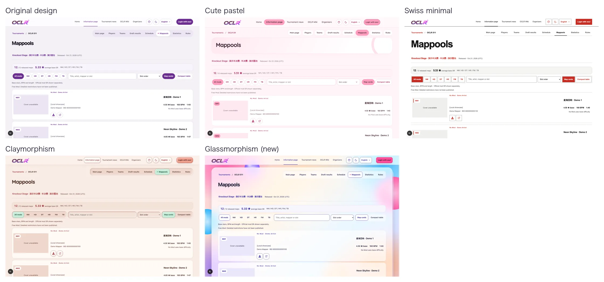
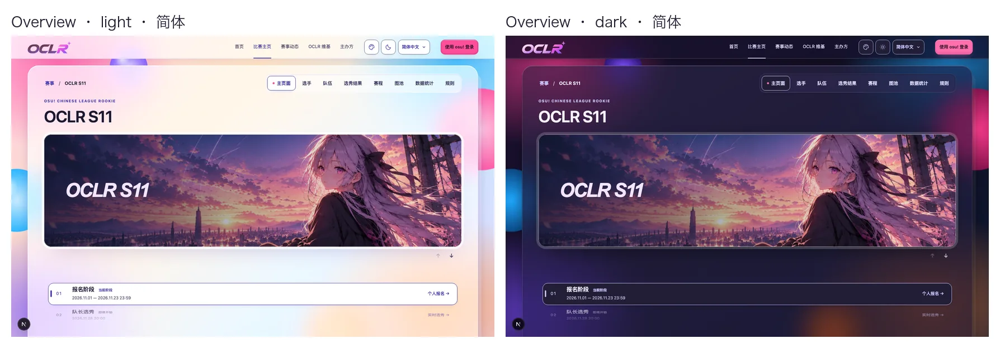
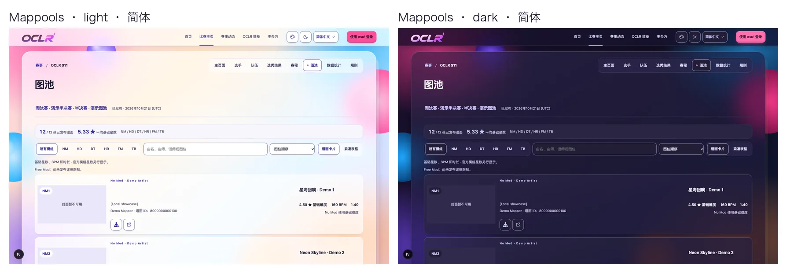
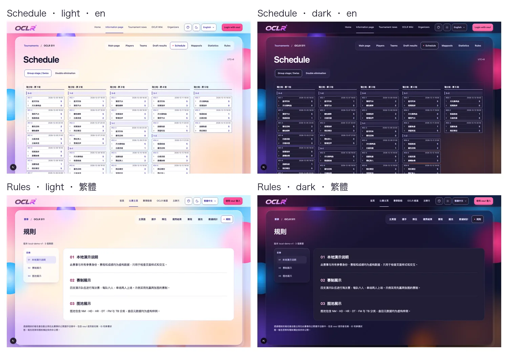
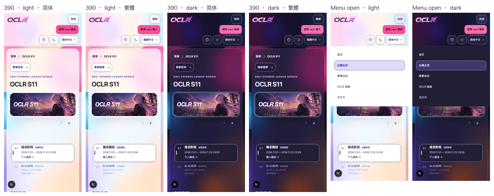
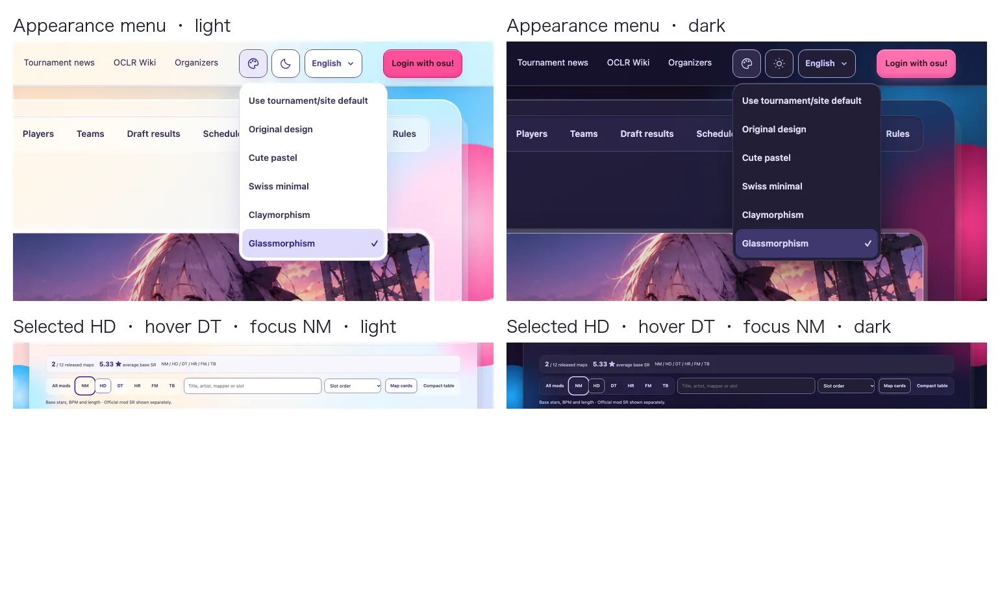
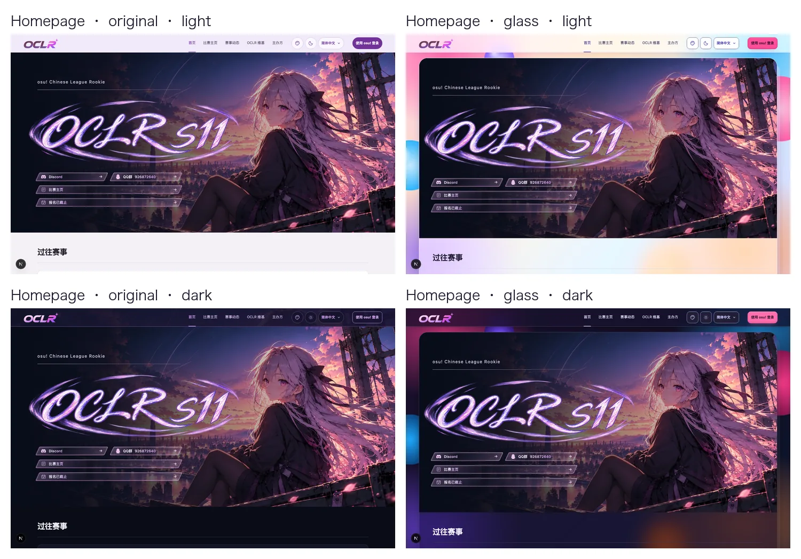
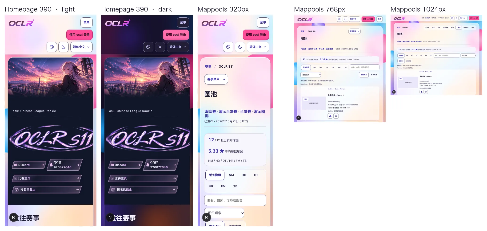
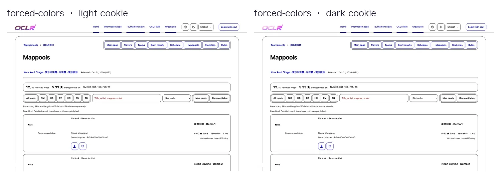

# Issue #240: Glassmorphism appearance

`glassmorphism` is a fifth optional appearance next to the original design,
cute-pastel, swiss-minimal and claymorphism. Visitors pick it from the header
menu, global Admins can make it the site default, and edition Admins can make it
a tournament default. Priority, cookie handling, light/dark independence and
OBS/presenter isolation are unchanged.

## Design

Layered glass, back to front:

1. **Colour field:** a fixed, vivid field of pink, orange, sky and violet orbs
   over a pastel gradient, plus four floating glass spheres. `.themed-site`
   itself keeps a solid `#f1edf8` background; the field is decoration only.
2. **Glass board:** one frosted pane (`blur(36px) saturate(160%)`) carries each
   page's content, with a bevelled rim (bright top, dim bottom), a sheen, layered
   drop shadows and a thinner sheet peeking out behind it. The spheres sit on the
   board's edges, crisp outside it and frosted underneath, so the pane reads as
   real glass.
3. **Glass tiles:** panels, tables, cards and the overview hero are lighter
   tiles on the board with their own rim and drop. They never blur and never
   stack (a tile inside a tile is solid).
4. **Solid top layer:** inputs, selected chips, header menus and dialogs are
   solid. Header menus cannot blur because they sit inside the blurred header.

The header and footer are glass bars on the field. Hero artwork stays literal
inside a glass mat and rim.

- **Contrast (deliberately different from the issue's 94–96%):** panes are
  50–72% opaque. Because the field is fully controlled by the theme, every text
  token was checked over its most saturated colours, unblurred and with the
  saturate boost applied: text ≥4.5:1 and control edges ≥3:1, with or without
  blur. The sticky header was also checked over black and white content.
- **Palette:** ink `#1b1830` text, indigo `#3a2fa6` links, selection and focus,
  and a glossy hot-pink `#ff4f9a` primary with dark `#2a1020` text. Dark mode is
  smoked glass over a deep field with darker spheres.
- **States without transparency or shadows:** selected/pressed is a solid
  chip with an indigo border and bold text, hover only tints, disabled is a
  dashed edge plus the existing opacity, and focus is a 3px solid ring with a
  4px offset.
- **Fallbacks:** without `backdrop-filter` support, and under
  `prefers-reduced-transparency: reduce`, every pane falls back to a solid
  surface. `forced-colors` hides the field and spheres and removes blur and
  shadows. `prefers-reduced-motion` removes transitions.
- **Homepage header:** follows glass only when glassmorphism is selected; the
  other appearances keep the S11 home palette from `home.css`.
- **Type:** system sans at 500/600. No remote font requests.

All screenshots use the local demo seed (`npm run db:seed:dev`); names, dates and
scores are demo data.

## Local verification (2026-10-24)

After merging the latest `main` (with #299, so this migration is now `0040`):

- `npm run lint` and `npm run typecheck`: no errors.
- `npm test` on the isolated `oclr_glass_test` database: 966 passed, 1 skipped
  (the same skip as on `main`), including the new 0040 migration upgrade test.
- `npm run build` passed; `npm audit --omit=dev` found 0 vulnerabilities.
- `npm run i18n:extract` and `npm run test:i18n` passed.
- Dev-server screenshots at 320/390/768/951/1024/1440px, spread across the three
  locales and both themes, showed no horizontal overflow and no script errors.
  English header geometry at 951/1024/1100/1101px stays within 4px of the
  original design.
- Computed styles in Chromium confirmed the translucent fills and blur on the
  header, board and footer only, solid fills with `backdrop-filter: none`
  under emulated `prefers-reduced-transparency: reduce`, and no blur, shadows,
  field or spheres under forced colours. Sticky sidebars still stick inside the
  board.
- Playwright e2e was not run locally; CI is authoritative for the complete suite.

## Not covered here

- Organizer confirmation of the style direction and name, including the
  50–72% pane opacity in place of the issue's 94–96%.
- Organizer review of the new Chinese label 毛玻璃风 / 毛玻璃風.
- Login, Admin, Player and Captain pages were not screenshotted locally (no osu!
  OAuth configured); they share the same tokens and are covered by CI e2e.
