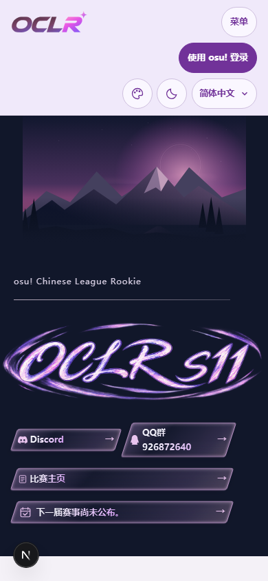
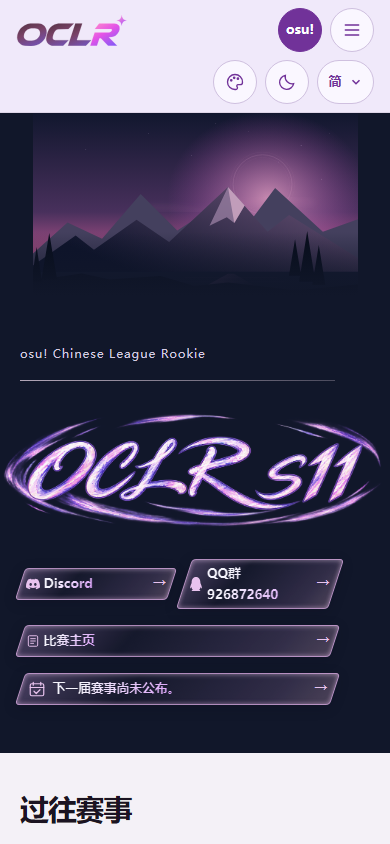

# Issue #295 — compact mobile header

Base: `5c5b3a3` (upstream main, including #297). Local verification:
2026-10-24, America/Los_Angeles. Initial baseline evidence used `030c29b`.

## Behavior

At widths up to 760px, the shared header uses two explicit grid rows: logo,
account and navigation trigger above appearance, brightness and language.
The menu trigger is icon-only; signed-in controls retain the avatar, accessible
dashboard name and existing player/staff destinations. The compact signed-out
control retains the full accessible sign-in name. Language triggers show
`简`, `繁` or `EN`, while their menus and accessible names retain full language
names and the selected state. Desktop navigation and full labels are retained.
The anonymous remote-development connection also gets a compact icon, avoiding
a long English connection label colliding with the logo at 320px. Clay's narrow
desktop breakpoint fix is inherited from #297, keeping the existing navigation
and account menus inside the viewport without duplicating that upstream change.

Navigation closes on Escape, outside pointer interaction or focus moving to
preferences. Existing dashboard and preference menu keyboard behavior remains
covered by the overlap regression tests from #182.

## Screenshots

Both 390×844 screenshots use the anonymous homepage, Simplified Chinese,
default appearance and light mode, without a database or real account.
The before image comes from unchanged `030c29b` in a separate checkout
(Next.js development badge visible); after comes from the production build.
The header decreases from approximately 168px / three rows to 113px / two rows.

| Before                                       | After                                           |
| -------------------------------------------- | ----------------------------------------------- |
|  |  |

Additional evidence: [staff menu and retained avatar at 360px](staff-360-menu.png)
and [desktop navigation at 1440px](desktop-1440.png). Account screenshots use only
synthetic test identities.

## Verification

- `npm run check`: passed (ESLint, Next.js route generation, TypeScript).
- `npm run build`: passed.
- `npm audit --omit=dev`: no vulnerabilities.
- `npm run i18n:extract`: no catalog content changes.
- `npm run test:i18n`: 4 passed after allowing the literal `osu!` brand in the
  existing hardcoded-English guard.
- Initial Chromium touch / Firefox touch smoke check: 2 passed.
- Expanded header regression: 124 cases executed; initially 109 passed and 15
  exposed English accessible-name and Clay intermediate-width issues. After the
  accessible name was corrected and the branch rebased onto #297's Clay fix,
  all 24 affected Chromium desktop/mobile and Firefox cases passed in the final
  focused run (2.2 minutes). The entire matrix was not repeated after those fixes.
- Manual remote-development check at 320px in Chinese and English: two rows,
  44px account target, no horizontal overflow and working language switching.

The expanded overlap matrix includes widths 320, 360, 375, 390 and 430px,
intermediate breakpoints and desktop widths through 1440px; all three locales,
four registered appearances and light/dark; anonymous, player and staff states.
It measures actual visual rows including the logo and every control, checks
44px touch targets and hit testing, and exercises viewport containment, focus,
Escape, menu dismissal and theme switching. The branding and account suites
also exercise accessibility and existing dashboard permission boundaries.

Tests use isolated local PostgreSQL databases named `oclr_issue295_test` and
`oclr_issue295_preview_test`; no demo/production database or real OAuth is used.
Windows reserves TCP port 3100 on this machine, so browser checks temporarily
substitute loopback port 43195 and restore the original test/config files after
the process exits. This local accommodation is not part of the patch.

## Full-suite limitations

The initial `npm test` run completed with 872 passed and 67 failed tests
(121 passed / 13 failed files). This includes the subsequently fixed i18n guard
failure; its focused rerun passes all four tests. The other failures concern
unmodified Linux shell/deployment, replay/media storage, migration-message locale
and Developer mutation-inventory tests. This is not a green full-suite result.

A separate unchanged `030c29b` checkout reproduced failures in all seven sampled
files: Developer mutation inventory, edition migration, replay parsing/storage,
team media, production shell and cleanup shell (14 passed / 24 failed tests, plus
the cleanup suite's missing `/bin/sh` error). Observed causes include missing
Unix programs, Windows symlink/private-storage behavior, translated PostgreSQL
errors and backslash paths in route enumeration. No unrelated platform fixes are
included here.

The full site browser suite and CI have not been run for this patch. Browser
results are local Playwright Chromium/Firefox emulation, not an Android hardware
test. Organizer preview and Android Firefox/Chrome confirmation remain external
acceptance steps; the issue stays open.
