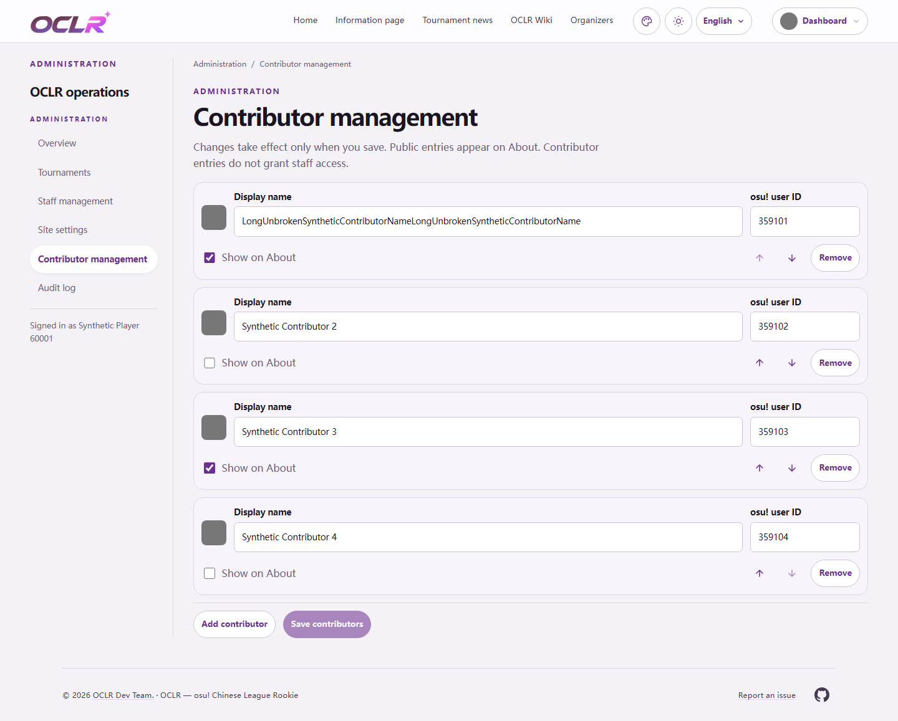

# Contributor management density (#359)

The `/admin/contributors` editor now uses compact rows: a 40px avatar, a single
editable display name, a bounded ID field, and adjacent visibility/reorder/remove
controls. The fields respond to the available workspace width rather than the
viewport. The page heading, explanatory text and list gaps also take less space.
The footer separates Add from the primary Save action and reuses the existing
translated “Unsaved changes” message. No new interface wording or API changes.

The organizer's follow-up replaces the Move up / Move down text controls with
borderless SVG arrows. Each arrow retains a 44px hit area, a translated hover
title, its numbered accessible name, keyboard activation and disabled endpoints.

The original save/revision contract, validation, public visibility, automatic
audit, authorization and read-only wrapper are retained. New entries, edits,
reordering, visibility changes and removals still require an explicit save.

## Actual before/after pages

Both versions were built in separate local checkouts. The baseline is upstream
`7b402d6`; the after images use this change. Screenshots come from the real
authenticated `/admin/contributors` route, with identical four-entry synthetic
fixtures, English, default appearance and 1000px viewport height. The avatar
provider is intercepted by the test browser with a gray SVG; no real accounts,
private remote data or production database were used. These are full-page browser
captures, without CSS overlays or image editing.

| Width | First long-name row before | After | Reduction |
| --- | ---: | ---: | ---: |
| 1440px | 380.09px | 156.84px | 58.7% |
| 390px | 580.97px | 295.69px | 49.1% |

Measurements are the same in light and dark. Raw geometry is recorded in
[before-measurements.json](before-measurements.json) and
[after-measurements.json](after-measurements.json). The comparison uses the same
long unbroken name, so it includes the baseline's repeated-name wrapping cost.
The editable input retains its complete value even when its visible text scrolls.

| View | Before | After |
| --- | --- | --- |
| Desktop light | [1440px](before-1440-light.png) | [1440px](after-1440-light.png) |
| Desktop dark | [1440px](before-1440-dark.png) | [1440px](after-1440-dark.png) |
| Mobile light | [390px](before-390-light.png) | [390px](after-390-light.png) |
| Mobile dark | [390px](before-390-dark.png) | [390px](after-390-dark.png) |

## Verification on 2026-10-27

- Node.js 24.19.0, `npm ci`, final `npm run check`, production build,
  `git diff --check` and `npm audit --omit=dev` passed (zero production findings).
- `npm run i18n:extract` and `npm run test:i18n` passed. Extraction produced no
  semantic catalog changes; catalog formatting and generated Next type references
  were restored after verification.
- `vitest run tests/integration/contributors.test.ts tests/unit/i18n.test.ts`:
  **2 files / 13 tests passed**, including publication, role boundaries, concurrent
  revisions, audit rollback and HTTP authentication/origin validation.
- `npm run test:e2e -- contributors.spec.ts`: **4 tests passed**, desktop and
  mobile. See [browser.log](browser.log). Both workflow tests cover empty/add/edit,
  invalid IDs, duplicate IDs, keyboard reordering, sorting endpoints, visibility,
  explicit save/reload, removal, saving-disabled fields, transport failures,
  successful retry, public About projection and stale-version rejection.
- The two presentation tests cover 13 registered appearances × three locales ×
  two themes × two widths per project: **312 layout checks**, including 320/390px
  mobile and 768/1440px desktop. Controls stay inside the workspace, inputs/buttons
  and checkbox labels have at least 44px targets, avatars are 40px, and the document
  has no horizontal overflow. **156 scoped Axe AA scans found no violations**;
  no page errors were observed. The worker creates its own synthetic Admin grant,
  so it does not depend on an ambient `ADMIN_OSU_IDS` shell setting.
- Before/after capture tests also passed against the same isolated browser DB,
  using the repository's guarded Playwright server configuration.
- The arrow follow-up passed lint/types, production build and all four contributor
  browser tests again, including the full locale/theme/appearance matrix. The
  current after images and geometry were recaptured from that production build.
  This ran in a separate verification checkout while the requested live dev
  preview continued to use its own database. The earlier full-suite, integration,
  i18n and dependency-audit results above were not rerun for this visual change.

### Full-suite limitations

The full `npm test` run was **not green**: 153 files passed / 15 failed;
1254 tests passed / 68 failed / 3 skipped. See
[full-suite-summary.txt](full-suite-summary.txt) for every failed test title.
Failures include unavailable Unix shell tools, Python3 fixture compression,
Windows symlink permissions and POSIX assumptions in durable media paths.
`read-api-dx` also reports generated extended-contract drift; running its generator
check against the unchanged `7b402d6` baseline reproduced that failure. This change
does not modify those implementations or claim a complete Linux CI pass.

The full-site functional/remote browser matrices were not rerun; current CI is
tracked on [Draft PR #394](https://github.com/OCLR-dev/OCLR-website/pull/394).
Only clearly named local
`oclr_issue359_test` and `oclr_issue359_browser_test` databases were migrated and
used. The initial verification stopped its loopback PostgreSQL instance; it was
restarted for the organizer-requested interactive preview at
`http://localhost:31359/admin/contributors`, using synthetic fixture data and the
ordinary session checks. That preview remains running for review.
No production operations, issue closure, main merge or deployment are performed.

The layout follows the repository-required
[Refactoring UI skill](https://github.com/LovroPodobnik/refactoring-ui-skill/blob/main/.claude/skills/ui-refactor/SKILL.md),
especially its hierarchy and spacing references, within existing MainSheet tokens.
