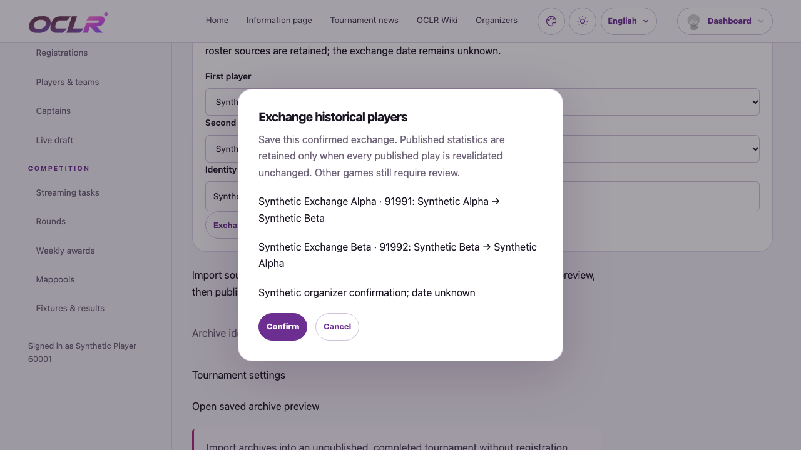
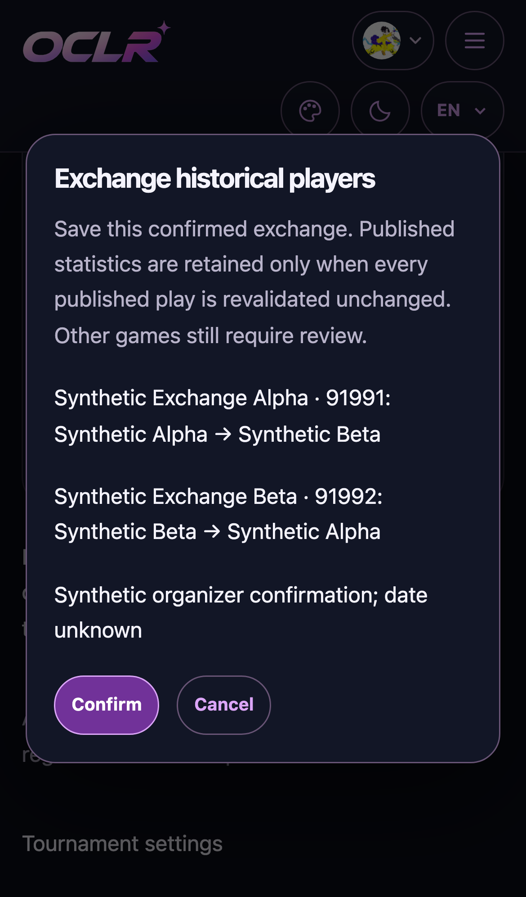
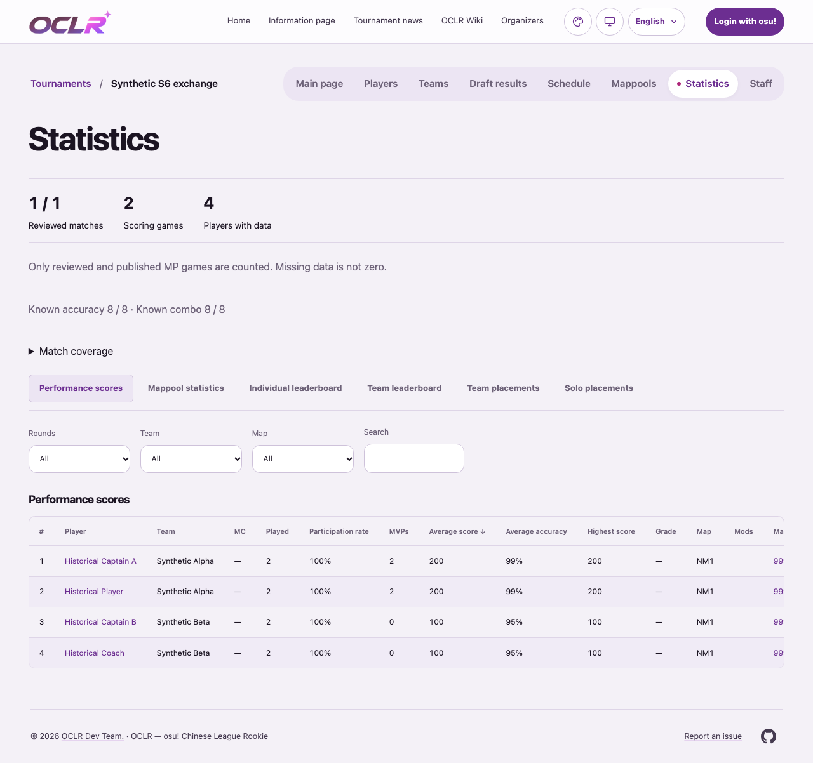

# Historical player exchange verification

2026-10-27; based on main `8c2edfc`. Related issue: [#366](https://github.com/OCLR-dev/OCLR-website/issues/366).

The new archive command exchanges two organizer-confirmed recorded players in a
completed final-Tier archive. Original team preconditions prevent a repeated
request from swapping them back. The existing statistics-preservation transaction
is shared with confirmed substitute additions: current releases survive only if
their selected plays and complete fixture scores revalidate unchanged. Source MP
data, score exclusions, selections and publication times remain intact. Changed
published attribution rejects the whole transaction. Private or stale snapshots
do not become published or current merely because the roster was corrected.

## Local verification

- Node 24.22.1; `npm ci` with the existing lockfile.
- `npm run check`, final production `npm run build`, `npm run i18n:extract`,
  `npm run test:i18n`, and `git diff --check` passed. Production audit: 0 vulnerabilities.
- Full `npm test`: 168 files passed, 1,346 tests passed, 1 existing platform test
  skipped. Two additional multi-MP/stale-release cases were then added; the final
  affected four-file run passed all 42 tests, including the shared substitute
  preservation regression and catalog checks. The complete batch was not repeated.
- Desktop/mobile existing `archive-statistics.spec.ts`: 8/8 passed, covering early
  season navigation, S1–S10 import/review/publication, adjudication and exclusions.
- Final desktop/mobile `archive-player-exchange.spec.ts`: 2/2 passed, including
  light/dark Axe checks and viewport width checks. An actual UI confirmation
  retained the release's plays, selected games, raw source, exclusions and original
  publication time; a separate unauthenticated browser could still read it, but not
  the Admin API or private confirmation evidence. Final viewport proof capture was
  also 2/2. Initial browser runs caught test setup/selector issues (a referenced
  edition-row deletion and ambiguous nested select labels); these were corrected
  before the successful runs, without relaxing application safeguards.
- All database/browser fixtures used the newly created, isolated
  `oclr_366_exchange_test` database and synthetic identities/MP data only.

The integration cases also cover edition-scoped authority, strict input, stale
configuration/team preconditions, parallel exchanges, source/audit preservation,
unchanged multi-MP releases, rollback when a published participant would move,
and refusal to bless unrelated edits or revive stale releases.

## Review and deployment limits

This change has no migration and does not modify real S6 records. Merge/deployment
and the subsequent explicit organizer confirmation remain separate. It does not
add replacement-history attribution, resolve unrelated UIDs or publish pending
statistics. New Simplified/Traditional Chinese exchange labels and explanations
are included in the catalogs for organizer review; local tests do not establish
that wording approval or a CI pass.

The form reuses existing MainSheet panel/field/dialog tokens, following the
project-required [Refactoring UI guide](https://github.com/LovroPodobnik/refactoring-ui-skill/blob/main/.claude/skills/ui-refactor/SKILL.md).

## Synthetic browser evidence

