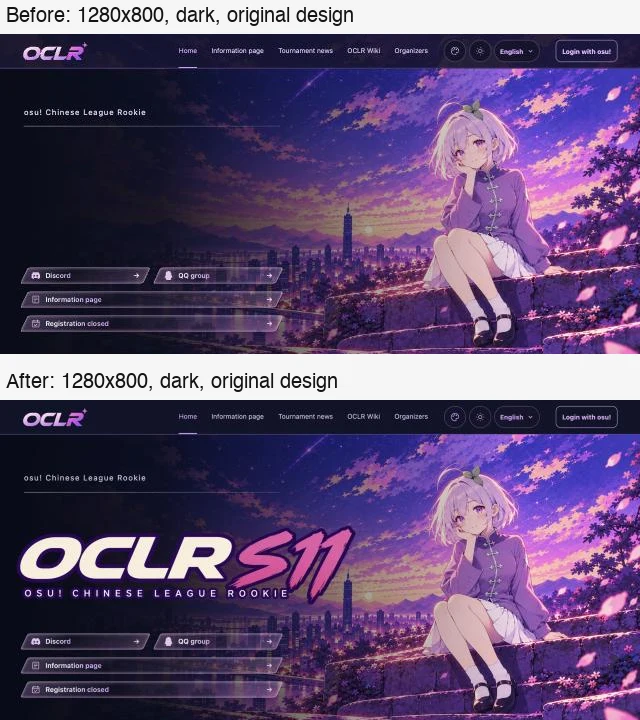
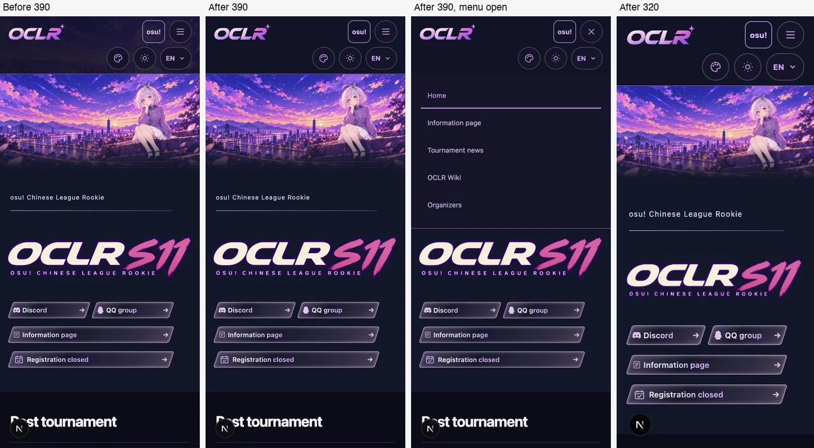

# Dark homepage header background (#376)

Organizer report: in dark mode the homepage top bar showed the S11 banner
illustration behind the logo, navigation and controls.

## Change

`src/app/home.css` no longer gives the dark homepage header its own
`background` (a gradient over `/oclr-s11-website-background.webp`). The light
rule's `background: var(--site-header)` now paints the dark header token
(`#111329`), with the existing 1px `--color-border` (`#795394`) line above the
hero. Hero artwork, header tokens and other appearances' rules are unchanged.

The removed declaration had specificity (0,4,1), which beat appearance header
rules at (0,3,1). The banner therefore also showed in dark mode for
cute-pastel, swiss-minimal, skyline-pop, glacier-blue and sakura-circuit. Dark now layers
appearance header styles the same way light does; glacier-blue regains its own
ice gradient in dark.

## Local validation

Logged out on the synthetic preview database, `/` at 1280×800, 390×844 and
320×700. Logged-in states were not checked (no local OAuth).

- Computed header background for all 12 registered appearances (including
  sakura-circuit from #378, re-checked after merging main) in light and dark:
  no S11 image anywhere; light values identical before and after.
- Sticky header after scrolling; appearance and language menus and the mobile
  navigation drawer open with readable panels.
- `npm run check`, `npm test` (isolated `oclr_376_test`: 1349 passed,
  1 skipped), `npm run build`, `npm audit --omit=dev` (0 vulnerabilities).
  Playwright is left to CI.

The desktop “before” capture was taken before the S11 logo image finished
loading; the logo is unaffected by this change.

