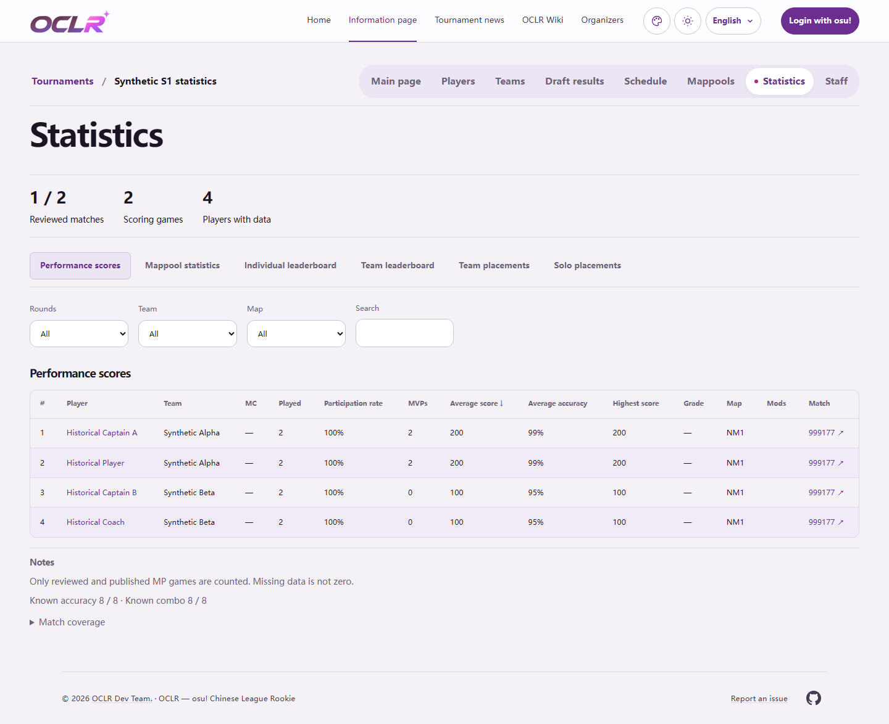

# Historical page notes — #401

Baseline: `955db510e976d5296522f5ae9b00be4c3e3bcb49` (upstream main).
Local verification on Windows, Node 24.19.0, with separate disposable PostgreSQL
test databases. This evidence does not establish deployment or organizer acceptance.

## Public-page inventory

| Pages / shared renderer                  | Treatment                                                                                                                                                                                                                                                                                             |
| ---------------------------------------- | ----------------------------------------------------------------------------------------------------------------------------------------------------------------------------------------------------------------------------------------------------------------------------------------------------- |
| S1–S10 Statistics / `EventStatistics`    | Reviewed-match, scoring-game and player totals remain first. Counting policy, known accuracy/combo, match coverage and mappool denominator explanations follow the table. Existing round/team/map scopes and calculations are unchanged.                                                              |
| Alternate `StatisticsExplorer`           | Counting policy, technical-adjudication explanation, calculation details and match coverage share the same notes section after the main table and any selected player details.                                                                                                                        |
| Historical Schedule, Results and Bracket | Derived S8 standings policy and recorded-appearance limitations follow the **whole page**, including the schedule's match-information table. The checkbox, source-evidence explorer, scores and match status remain with the competition UI.                                                          |
| Historical final-Tier Draft results      | The missing-selection-order explanation follows all allocations.                                                                                                                                                                                                                                      |
| Historical Mappools                      | Current-base-metadata supplementation notices move out of repeated cards, compact rows and dialogs to a pool-local notes list after the maps. Each notice retains its slot, fields, source link and capture date; the list follows map filters. No notes section is rendered without supplementation. |
| Legacy rule-source fallback              | Rule text remains in the rules content; its already-visible source attribution moves to page notes with the original rule label. Original rulebooks, version metadata, figures and navigation remain in place.                                                                                        |
| Teams, Players and Staff                 | Identities, roles, unresolved roster entries and replacement records remain core archive content. Raw source strings still follow the existing `showSources` boundary. Pages without supplementary notes have no notes section.                                                                       |
| Match details                            | Results, actual scoring policies, incomplete-data states and unavailable/error states remain in context. No wording removed by #377 is reintroduced.                                                                                                                                                  |

`PageNotes` uses MainSheet text/border tokens, a small translated heading, a thin
separator and compact spacing. It is a page-local section before the site footer.
It does not change publication projections or expose archive `notes`, private
source appendices, review reasons or management records.

## Same-viewport before / after

Light mode, English, default appearance; desktop **1440 × 950**, mobile
**390 × 844**, full-page captures. S1 statistics and S5 allocations use synthetic
fixtures; S8 uses the repository's existing public archive import. Both versions
use identical data and preferences. Captures were visually inspected.

| Representative page                    | Desktop                                                                               | Mobile                                                                              |
| -------------------------------------- | ------------------------------------------------------------------------------------- | ----------------------------------------------------------------------------------- |
| S1 statistics                          | [Before](s1-statistics-desktop-before.png) · [After](s1-statistics-desktop-after.png) | [Before](s1-statistics-mobile-before.png) · [After](s1-statistics-mobile-after.png) |
| S5 final-Tier allocations              | [Before](s5-draft-desktop-before.png) · [After](s5-draft-desktop-after.png)           | [Before](s5-draft-mobile-before.png) · [After](s5-draft-mobile-after.png)           |
| S8 schedule, standings and match table | [Before](s8-schedule-desktop-before.png) · [After](s8-schedule-desktop-after.png)     | [Before](s8-schedule-mobile-before.png) · [After](s8-schedule-mobile-after.png)     |

[capture.ts](capture.ts) reproduces the comparisons from the repository root with
`node --import tsx docs/verification/issue-401/capture.ts`. It requires explicitly
exported `TEST_DATABASE_URL` and `DATABASE_URL` targeting the same disposable
migrated test database, both built checkouts, and the baseline checkout at
`../OCLR-issue401-before`. It seeds test editions only and starts/stops its own
loopback servers on 31401/31402.

## Actual checks

After syncing upstream main `ab4c3e7`, lint/types, production build, focused unit
checks and component/production browser checks were rerun successfully.

- `npm ci`, `npm run check`, production build and `git diff --check`: passed.
- `npm run i18n:extract` and `npm run test:i18n`: run; all four i18n checks passed.
  Extraction also discovered two pre-existing uncatalogued storage-error messages;
  those unrelated generated additions were excluded from this change.
- Focused unit checks: **7 files, 73 tests passed**, including empty/multiple notes,
  i18n, archive support/navigation, statistics and mappool calculation regressions.
- DB-free component browsers: **6 passed** across desktop/mobile, including the newly merged statistics-manager
  harness. Both statistics
  renderers retain interactions; Explorer coverage and method details expand by
  keyboard, update with rounds and remain after selected player details.
- Focused production-browser checks: **12 passed** across desktop/mobile, including
  S1–S10 statistics, round/team/map filters, coverage links and keyboard expansion,
  all **19 registered appearances** in both brightness modes, all three locales
  distributed across appearances, empty notes, private-marker non-disclosure,
  mappool supplementation/denominators and S7–S10 bracket/standings regressions. Default notes
  also pass the scoped axe check. This is not every locale × appearance combination.
- `npm audit --omit=dev`: **0 vulnerabilities**.
- Full `npm test` at the original implementation `6bbedea`, before syncing main: **175 files passed / 16 failed; 1478 tests passed / 66 failed /
  3 skipped**. Rerunning those 16 failed files on unmodified baseline main reproduced
  the **same 66 failures and identical failed-test names** (28 other tests passed,
  3 skipped). Failures concern Linux shell commands, Windows fsync/symlink support,
  and Python/replay/import tooling; no related statistics/notes check failed.
- Full browser regression (1036 tests) was invoked with `--max-failures=5`, then
  interrupted to sync newly landed upstream changes and resolve the harness
  conflict. It is **not** a full-suite pass. The focused 12-test production-browser
  run above passed after the merge; the complete browser suite remains for CI.

The only new interface copy is **Notes / 备注 / 備註**; the Chinese heading awaits
organizer review. Existing explanatory wording and data semantics are retained.
CI and maintainer acceptance remain separate from these local results.
