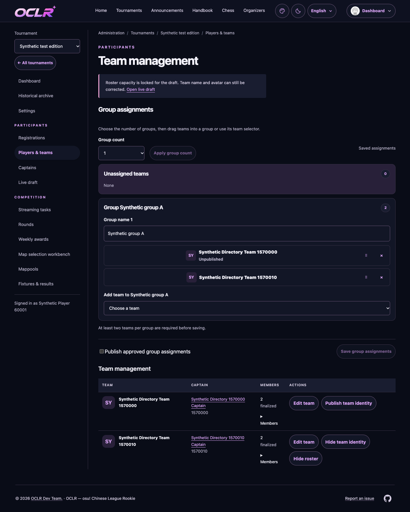
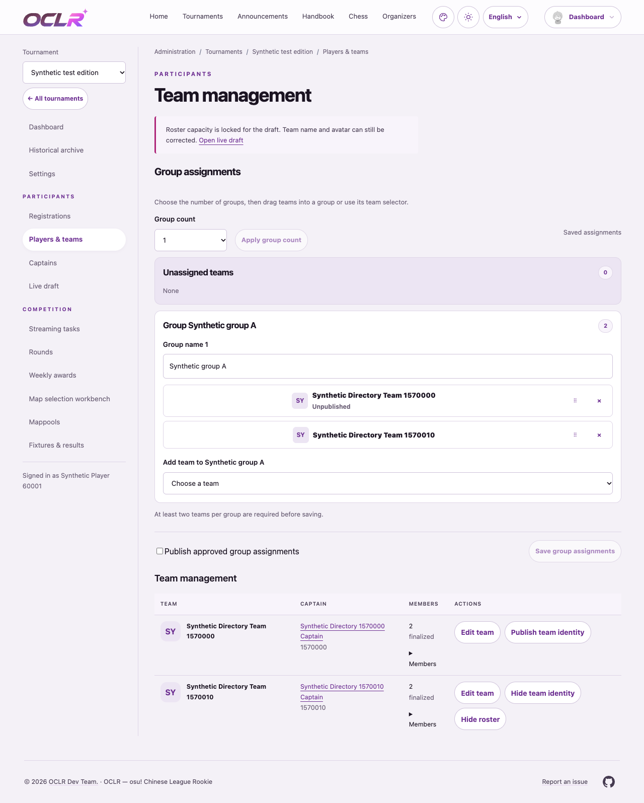
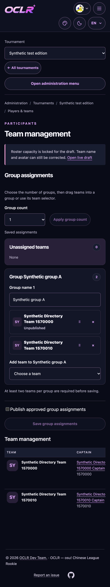
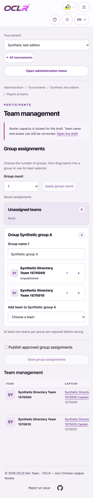

# Team management correction (#592)

Requested behavior: captain appointment creates a private team automatically; team names and images are edited in Edit team; roster capacity belongs to General tournament settings and applies to every active team and future captain. The redundant captain/pool and bulk configuration sections are removed from Teams. Group assignment uses responsive cards with existing drag, picker, keyboard, save and publication behavior.

Existing saved team capacities remain intact until an explicit tournament setting change. Draft locks, finalized rosters, membership uniqueness, optimistic setup versions and separate publication are preserved. No database migration or deployment was performed. New Chinese helper/error wording remains available for organizer review.

Verification on Node 24.22.2 with fresh isolated PostgreSQL databases:

- `npm ci --ignore-scripts --offline`, `npm run check`, production build, i18n extraction/checks and `git diff --check` passed. Production dependency audit (offline): 0 vulnerabilities.
- Full Vitest initial run: 1,877 passed, 3 failed, 2 skipped across 234 files. The captain-removal test assumed the first team/member was the removed captain; it now selects that identity explicitly. Generated extended DTOs, coverage and OpenAPI were synchronized. The backup fixture initially omitted the runtime role from its test connection URL; rerunning with an explicit local test user passed, without changing operator checks.
- Affected rerun: captain/team transactions, backup, i18n and DX checks passed (30 tests); the remaining OpenAPI snapshot needed regeneration after extended DTO generation and was rerun separately with DX checks.
- Related real-page Chrome desktop/mobile: 4 passed across group assignment and team configuration. An existing team configuration test still clicked a removed Schedule tab; it now navigates to the existing Matches route. A dedicated temporary config used port 31952 because 3100 was occupied; it was removed after testing. These tests require no external provider calls.
- Component desktop/mobile: 9 passed, 1 mobile native-drag case skipped. Includes no per-team capacity input and group assignment interactions in the actual Teams styling wrapper.
- Actual light/dark desktop/mobile screenshots were inspected; saved below. Full-site browser regression was not run. CI status must be checked for the exact pushed commit and is separate from local verification.

