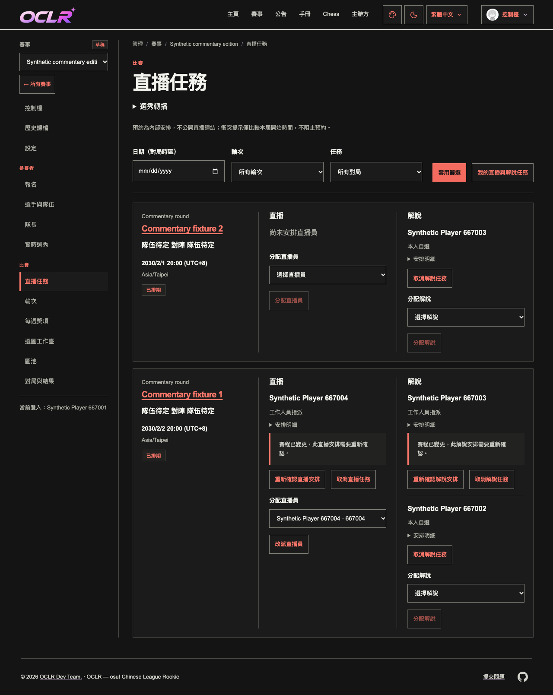
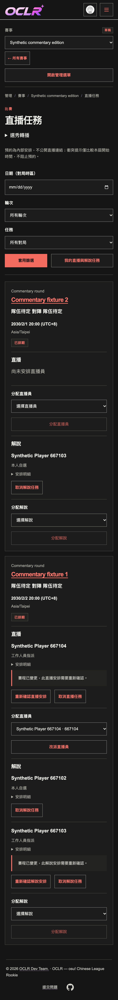

# Multiple commentary tasks (#667)

Organizer decision on 2026-11-01 (Asia/Taipei): one Streamer per fixture, with
multiple Commentators. Implemented on `codex/commentator-streaming-tasks` from
main `9a554caf99104d26bb35246411ef4c654e922e39`. The base commit's
[CI run](https://github.com/OCLR-dev/OCLR-website/actions/runs/41297774968) passed;
this is baseline evidence, not CI for this implementation.

## Behavior

- The existing Streaming tasks page has separate Streamer and Commentator sections.
  Multiple eligible commentators may join one match; assigning one person keeps
  the Streamer and all other commentators.
- Active global/edition Commentators can read this private workspace and claim,
  cancel or reconfirm their own commentary booking. Admins may assign, cancel and
  reconfirm individual commentators. Eligibility is checked again in the locked
  transaction, including after revocation when another role is still active.
- `fixture_commentators` has a composite fixture/user primary key. Both task kinds
  use existing fixture versions, stream revisions, role/edition/fixture locks and
  idempotent automatic audit events. Old Streamer request/receipt shapes remain
  supported; commentary requests add `task: "commentary"`.
- My broadcast tasks includes both roles. Same-start warnings include other
  broadcast roles; each person must reconfirm a changed schedule separately.
- Normal deletion requires commentary cancellations. Force-deletion previews and
  archives include commentary rows and reject stale fingerprints. Release checks
  require the new table. Existing public projections, Streamer credentials and
  referee addref identity retain their authorization boundaries.
- Migration `0069_commentator_tasks` adds the table without rewriting existing
  Streamer bookings, fixtures or history. Saved-read/OpenAPI contract is 1.17.0.
- Layout follows the repository's [Refactoring UI guidance](https://github.com/LovroPodobnik/refactoring-ui-skill/blob/main/.claude/skills/ui-refactor/SKILL.md),
  using existing MainSheet tokens and responsive components.

## Local verification

Node.js 24.22.2 with the existing npm lockfile (`npm ci`). Only separate
`oclr_667_test` and `oclr_667_browser_test` databases on a loopback PostgreSQL 17
instance were used. Existing environment files and running preview processes
were preserved.

- `npm run check`: passed.
- `npm test`: 256 files passed; 2,171 tests passed, 2 skipped.
- `npm run build`: passed.
- `npm run i18n:extract` / `npm run test:i18n`: passed (4 tests).
- `npm run read-api:generate`: synchronized 57 DTOs, OpenAPI and 176 coverage rows;
  full unit tests also checked generation consistency.
- `npm audit --omit=dev`: 0 vulnerabilities.
- Final fixture deletion regression: 10 tests passed, including commentary
  archival and complete removal of fixture-owned rows.
- Affected desktop/mobile browser checks: 6 tests passed (50.5 seconds), covering
  existing streaming/API access and multiple commentary assignments, own/peer
  permissions, rescheduling, idempotency, revocation, three locales, light/dark,
  three public appearances, accessibility and responsive widths.
- Affected ESLint and `git diff --check`: passed.

The first affected test run exposed that the unassigned filter must respect the
actor's eligible role; the corrected behavior passes the complete suite. Browser
setup was corrected to use independent synthetic scoped Admins, semantic control
selectors and explicit waits for saved assignment refreshes. These setup failures
are not reported as application test passes.

Browser tests use port 31667 and temporary copies of the two specs, provider
fixture and config, with matching origins and the existing isolation guards.
Temporary files are removed after execution. Logs and screenshots are retained
under `/private/tmp/oclr-667-*.log` and `/private/tmp/oclr-667-browser-results` on
the authoring machine. Full-site browser regression was not run.

## Visual QA

Desktop and mobile Traditional Chinese dark screenshots were visually inspected.
The final wording distinguishes commentary confirmations from streaming ones.

New Chinese action/error wording still awaits organizer review. No production
migration, deployment, real appointment or real-person rehearsal was performed.
Issue acceptance/closure remains with the maintainer; local results do not
establish per-commit CI or deployment acceptance.
