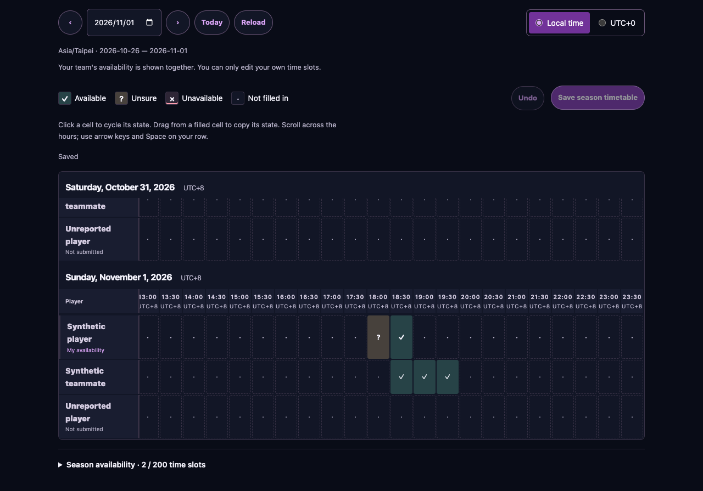
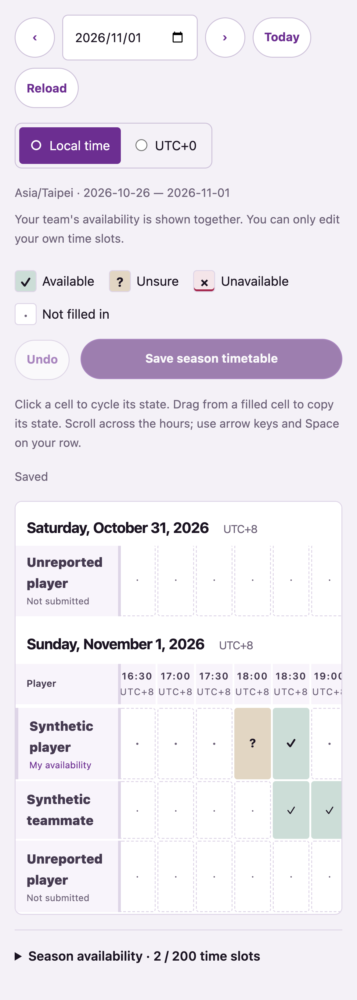

# #720 — horizontal season timetable

Implemented in the `codex/osusheets-workspace` batch on 2026-11-02, alongside #725.
Reference: <https://osusheets.team/bTocPKH3_6NGq_ANRFhUz>.

- Dated weekly tables align every authorized player's half-hour cells; only the
  current owner can edit. Existing captain-only team visibility is preserved.
- Click cycles available/unsure/unavailable/unfilled. Forward/backward mouse and
  touch strokes copy the origin state; undo restores an entire stroke. Arrow
  keys and Space operate the personal row. Changes save once with existing
  versions, private audit and idempotent retry keys.
- Local IANA time is the default, with UTC+0 switching. Both repeated fall-back
  hours have independent offsets/instants; spring-forward gaps have no cells.
  Old irregular boundaries remain intact until deliberately painted or removed.
- Optional status values reuse the existing private JSON; no DDL or migration is
  introduced. Missing status remains available, and conflicting overlaps fail
  validation. Per-fixture Schedule reports keep their existing independent data.

## Verification

Node 24.22.2, `npm ci`, dedicated disposable `oclr_osusheets_test` PostgreSQL
cluster on loopback, all existing migrations applied explicitly.

- `npm run check`: passed (lint and types).
- `npm test`: 264 files passed; 2,288 tests passed, two skipped, one i18n hardcoded
  UTC-label check failed. After wrapping the label and translating it, the
  affected four-file unit run passed all 17 tests, including all four i18n tests.
  The whole suite was not repeated after that correction.
- `tests/integration/player-workspace.test.ts`: all 21 tests passed in the full
  run and the focused persistence rerun, including the new states/owner/captain/audit/idempotency persistence case.
- `npm run build`: passed after the final layout/token corrections.
- `npm audit --omit=dev`: zero vulnerabilities.
- `npm run i18n:extract`, `npm run test:i18n`: passed after filling zh-Hans/zh-Hant.
- `npm run read-api:check`: 57 contracts, 181 inventory rows and eight tests passed.
- Focused component browsers: **34 passed** (desktop and mobile Chrome), including
  both sheets and the unaffected fixture Schedule selection. Clock-change tests
  use America/New_York, normal tests explicitly use Asia/Taipei.
- Added cases cover backward strokes, all states, mixed-state overwrite, undo,
  keyboard access, midnight/week boundaries, repeated DST hours and save retries.
- `git diff --check`: passed.

Screenshots below use synthetic identities and data. The four captured surfaces
show light/dark at desktop/mobile sizes. Later surface-token corrections and
semantic status roles preserve the layout shown. Full application E2E and the
full appearance/browser matrix were not run; these component checks do not
establish production deployment, real OAuth or organizer acceptance.

New Chinese wording prepared for review: 不确定／不確定, 尚未填写／尚未填寫,
部分填写或包含多种状态／部分填寫或包含多種狀態, 选择本周日期／選擇本週日期,
下一周／下一週, 今天, 本地时间／本地時間, 可用时间状态／可用時間狀態, 撤销／撤銷,
and the click/drag/keyboard help sentence in the catalogs. `UTC+0` stays literal.

