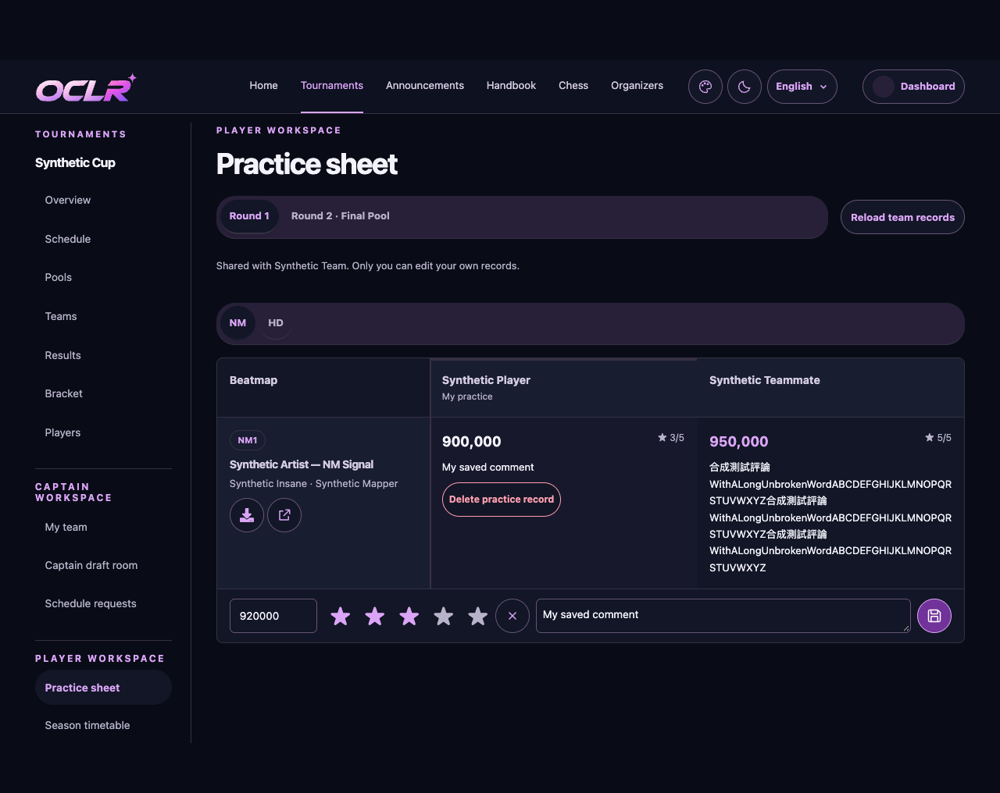
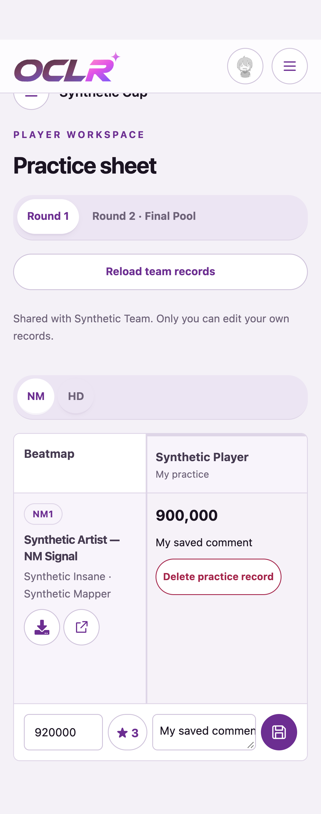

# #725 — team practice comparison

Implemented in the `codex/osusheets-workspace` batch on 2026-11-02, alongside #720.

Map rows and player columns replace repeated per-map teammate lists. The map
identity and column headings stay fixed when scrolling; each personal editor
stays inside the visible container. Score/rating/comment are visible together.
The highest saved score in the current map context is emphasized, including ties;
old-context and missing scores are excluded. Author-authored metadata/comments
remain literal. Existing pool/Mod tabs keep unsaved drafts mounted.

Owner save/delete, request-key retries, retained deletion versions and team
visibility use the existing services. No permission, score policy or storage
change is introduced by this practice-table update.

The batch passed lint/types, production build, dependency audit, read-contract
checks and affected unit tests. The initial full unit/integration run had one
new UTC-label i18n failure, fixed and rerun successfully; exact counts and gaps
are recorded in [the timetable verification](../issue-720/README.md).

All **34 focused component browser checks passed**, including score/rating/comment
alignment at 719px and 320px, fixed map/editor geometry under horizontal scrolling,
long literal comments, keyboard tabs, draft retention, delete cancel/retry/recreate
and read-only controls. Light/dark screenshots use synthetic data only. The later
surface-token correction preserves this layout. Full application E2E, the full
appearance matrix, production and organizer review remain separate.

