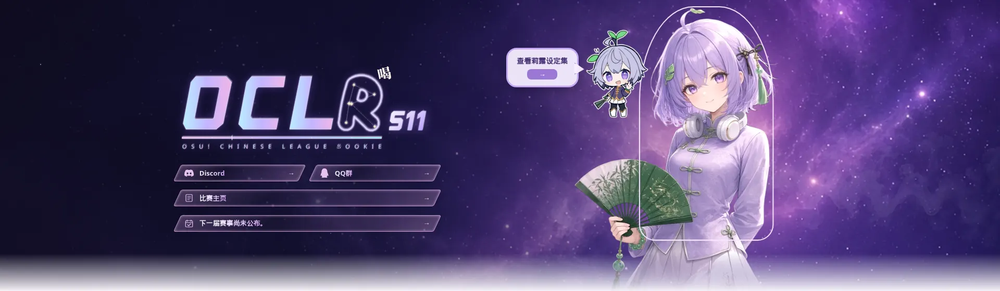
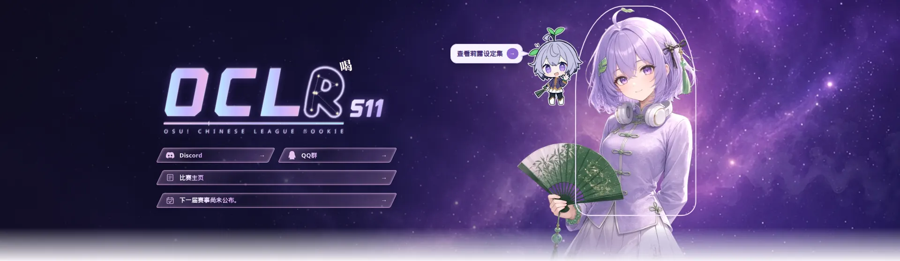
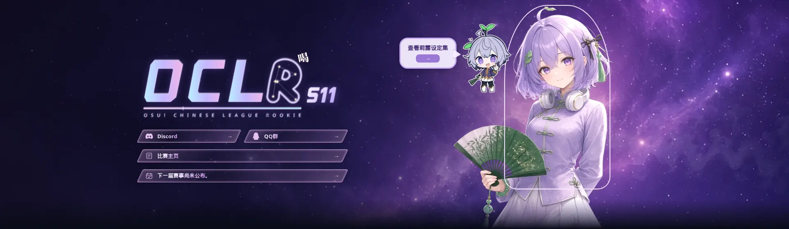
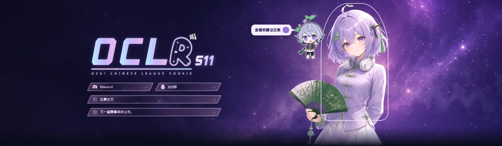
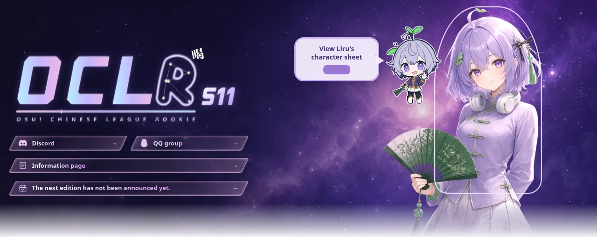
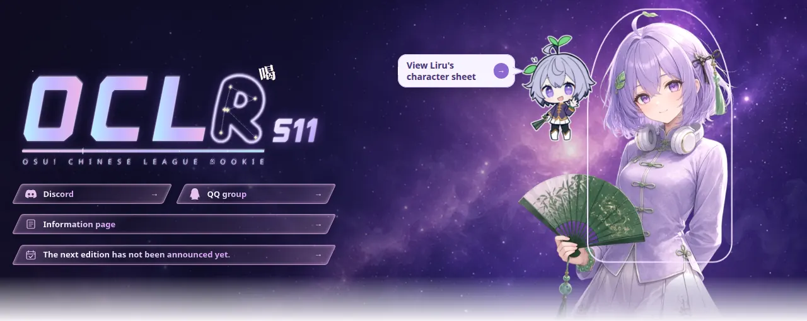
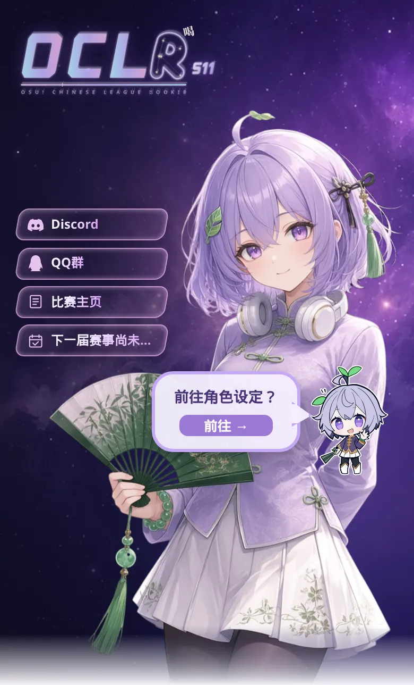
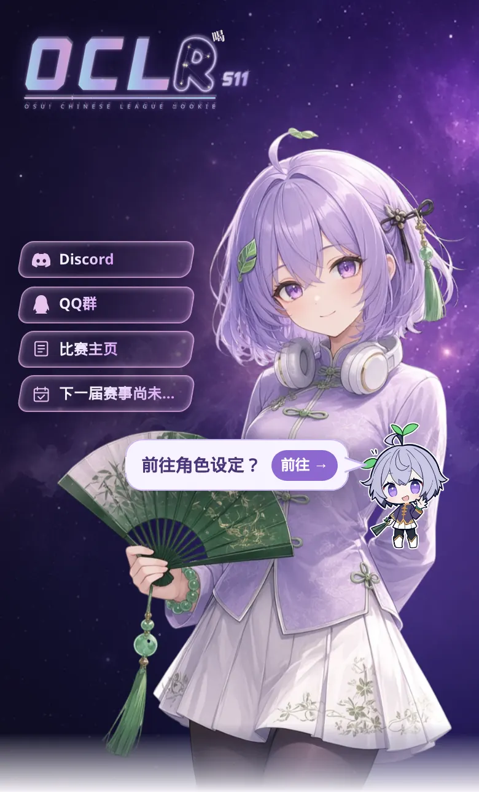

# #857 Liru character-sheet bubble

Homepage hero, local dev server, no database. The card frames are taken with
the pointer or keyboard on Liru (desktop) or with the touch prompt open
(phone). Simplified Chinese unless the file name ends in `-en`. Light theme
unless the file name includes `dark`.

The bubble keeps the link to `/wiki/liru`, the hover, focus and touch behaviour
from #638, and the same window size in each before/after pair.

|                                     | Before                             | After                             |
| ----------------------------------- | ---------------------------------- | --------------------------------- |
| Desktop 1920×990, light             |       |       |
| Desktop 1920×990, dark              |  |  |
| Desktop 1280×720, English, light    |    |    |
| Phone 390×844, light, after tapping |              |              |

What changed: the border is a 1.5px line with a 14px radius, the label and
arrow sit on one row, and the tail is a separate shape whose fill matches the
bubble and whose tip meets the chibi outline.
