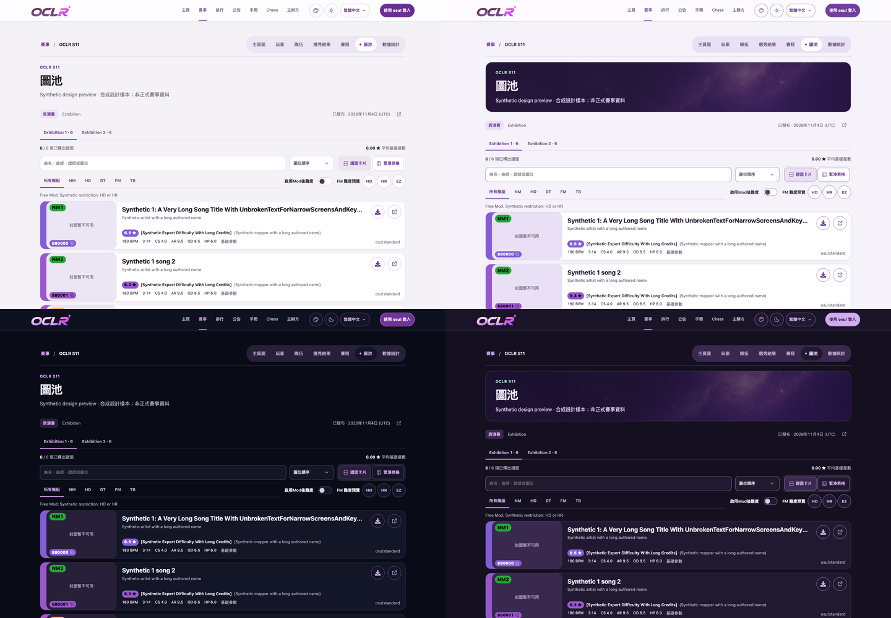
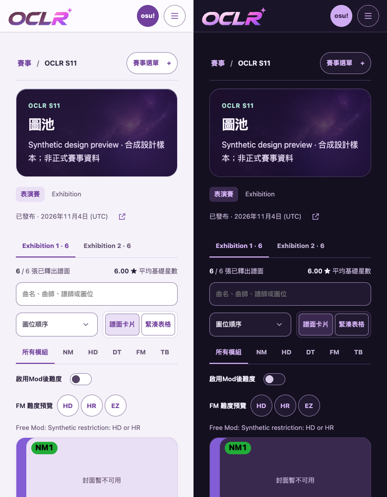

# S11 Nebula Bloom — implementation and design review

Date: 2026-11-06 (Asia/Taipei). Branch: `codex/858-s11-nebula-bloom`.
Base: main `ad7d568db4806a037ec310c8327815d9bb510245`.

The [design specification](../../design/nebula-bloom.md) explains how the theme
extends the default purple interface and reuses the current S11 artwork.

The [post-merge empty-state correction](empty-states/README.md) records the
organizer's teams/draft background reports and the shared CSS fix.

The [overview schedule surface correction](schedule-surface/README.md) records
the subsequent schedule report and removal of the document-wide solid fill.

Organizer correction: the mappool banner now uses the **pure purple nebula sky**
with pale text in both color modes. The previous preview incorrectly inserted
the complete S11 character/wordmark poster below the title; the corrected preview
matches the real mappool route's heading followed by pool controls and data.

## Matched comparisons

These captures use actual `Header`, `TournamentShell`, `PageHeading`,
`PublicMappools` and its real map dialog, with synthetic records in the isolated
component host. `PlayerTimeline` has a separate preview. The settings captures use the
actual `TournamentEditor`. They establish component rendering and interactions,
not live tournament data, authenticated page/SSR acceptance or deployment.

In the overview below, the left column is default and the right column is S11;
the top row is light and the bottom row is dark. Each source viewport is
1440 × 1000; the full-size captures linked below also include the data area.



| Size / mode             | Default                              | Nebula Bloom                          |
| ----------------------- | ------------------------------------ | ------------------------------------- |
| Desktop, light          | [Default](desktop-light-default.png) | [S11](desktop-light-nebula-bloom.png) |
| Desktop, dark           | [Default](desktop-dark-default.png)  | [S11](desktop-dark-nebula-bloom.png)  |
| Mobile 390 × 844, light | [Default](mobile-light-default.png)  | [S11](mobile-light-nebula-bloom.png)  |
| Mobile 390 × 844, dark  | [Default](mobile-dark-default.png)   | [S11](mobile-dark-nebula-bloom.png)   |

The full-page images include long authored map titles, card controls, filters
and difficulty metadata. The mobile mode comparison uses unscaled 390px crops:



## Interaction and accessibility evidence

[Machine-readable results](browser-results.json) record:

- All eight matched public previews: no page errors or horizontal page overflow;
  the banner resolves the pure nebula background and has no key-visual poster;
  Escape closes the map dialog and restores focus to its opener.
- axe WCAG 2 A/AA and 2.1 AA: zero violations in each preview and each open dialog.
  This automated result is limited to the rendered fixture states.
- S11 keeps the same season identity/link while the viewer uses `default`:
  [English](timeline-en.png), [Simplified Chinese](timeline-zh-Hans.png),
  [Traditional Chinese](timeline-zh-Hant.png). The existing November 26 point and
  participation status are retained; this work supplies no new season dates.
- Real edition appearance select accepts `nebula-bloom` and displays its localized
  label; [desktop/light](settings-desktop-light.png) and
  [mobile/dark](settings-mobile-dark.png) have no horizontal page overflow.
- Reduced motion computes the heading animation as `none`; forced colors remove
  the heading image ([mobile capture](forced-colors-mobile.png)).

Open-dialog previews: [desktop/light](desktop-light-nebula-bloom-dialog.png),
[desktop/dark](desktop-dark-nebula-bloom-dialog.png),
[mobile/light](mobile-light-nebula-bloom-dialog.png),
[mobile/dark](mobile-dark-nebula-bloom-dialog.png).

## Verification

With Node **24.22.2** and the existing npm lockfile:

The banner correction reran `check`, `test`, `build`, the production dependency
audit and the targeted browser captures. Installation, i18n and read-contract
results below are retained from the initial implementation, whose corresponding
inputs did not change in this correction.

- `npm ci` passed (initial restricted-network attempt failed; final cached
  installation and prepare completed).
- `npm run check` passed: lint, TypeScript and historical relation generation.
- `npm test` passed: **208 files passed, 81 skipped; 1,769 tests passed,
  790 skipped**, 163.20s. DB-dependent cases were skipped without an isolated
  `TEST_DATABASE_URL`.
- `npm run build` passed. The first sandboxed build stalled at compilation;
  the retry with local process permissions completed.
- `npm run i18n:extract`, `npm run test:i18n` (4 tests),
  `npm run read-api:generate` and `npm run read-api:check` (8 tests) passed.
  Generated contract identifiers change with the new enum; artifacts were
  regenerated rather than edited.
- `npm audit --omit=dev`: zero vulnerabilities.
- Prettier for affected code, documentation consistency/local links and
  `git diff --check` passed.
- Full E2E: **not run (too slow)**. The targeted browser design captures above
  were requested by #858 and add no E2E regression matrix.

The existing season-policy tests automatically cover the newly registered
appearance: authorized edition inheritance, ignored season visitor cookies,
public-only site settings, private edition checks and broadcast exclusion.
Existing asset/accent tests include the new theme. The timeline unit regression
checks the S11 appearance, date, authored name and published edition link.

## Reproduce

After `npm ci`, run the DB-free host with Node 24 in one shell:

```sh
COMPONENT_TEST_PORT=31458 node --import tsx tests/components/server.ts
```

Then, with installed Chrome:

```sh
node design/nebula-bloom/capture.mjs
```

The helper uses the existing component host and writes only this evidence
directory. It does not connect to a backend or save tournament settings.

Organizer design/Chinese naming review is pending. S11 default selection,
publication, deployment and commit-specific CI remain separate evidence.
