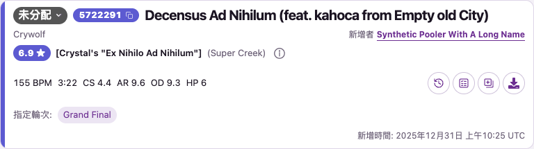

# Candidate creation timestamp display

Date: 2026-11-06 (Asia/Taipei). Based on main
`6eda730a65a4be981a28be0d51af17be1d66aa16`.

The organizer requested creation times on selection workbench candidate cards,
then selected a dedicated final row below the intended rounds. That row is
right-aligned and labelled **Added at / 新增时间 / 新增時間**; the author stays on
the artist row. `SelectionWorkspace` already supplies the saved
candidate `createdAt`; the card now renders it through the same `Stamp` helper
used for workbench comments. The existing locale-specific date/time format and
explicit UTC indicator are retained, with an ISO `time[datetime]` value.

The timestamp can wrap across the full footer width. The author's profile link
and long-name truncation retain the existing artist-row presentation. The new
label uses the standard three-locale message catalogs.

## Previews

The actual `SelectionWorkbench` component uses synthetic candidates. Creation
time is `2025-12-31T10:25:00Z`, deliberately different from its metadata-fetch and
workspace snapshot times (`2026-01-01T00:00:00Z`).

- [Traditional Chinese, light, 877px](zh-Hant-light-877.png)
- [Traditional Chinese, light, narrower workbench column](zh-Hant-light-877-narrow.png)
- [Traditional Chinese, dark, 390px](zh-Hant-dark-390.png)
- [Simplified Chinese, light, 320px, multiple rounds](zh-Hans-light-320.png)
- [English, dark, read-only, 877px, no intended round](en-dark-877-readonly.png)

[Browser results](results.json) record the exact ISO creation timestamp,
localized visible time with UTC, retained author URL, timestamp containment,
and page overflow checks. All five cases confirm that the time is below the
entire intended-round group and absent from the artist row, with no script errors
and zero axe WCAG A/AA violations within the beatmap cards.

The fixture supports `locale=en|zh-Hans|zh-Hant`, `theme=light|dark`, `readOnly`
and `narrow` on the existing `/workbench-compact` route. HTTP fixtures and artwork
requests are isolated; no private candidate data or live accounts were read.

## Verification

With Node 24.22.2 and the existing lockfile:

- `npm run check` and `npm run build` passed.
- `npm test`: 209 files passed / 84 skipped; 1,771 tests passed / 800 skipped,
  169.47s. Database-dependent cases skipped without an isolated test database.
- `npm run i18n:extract` and `npm run test:i18n` passed (4 tests).
- `npm audit --omit=dev`: zero vulnerabilities.
- Read-API regeneration and `npm run read-api:check` passed (8 tests); the
  generated artifacts have no changes because the timestamp was already in the
  saved-data contract.
- Formatting, affected-component lint, evidence links and `git diff --check`
  passed.
- Full E2E: not run (too slow). Targeted component browser checks above verify
  presentation and containment; live role/account checks and deployment are
  separate evidence.
