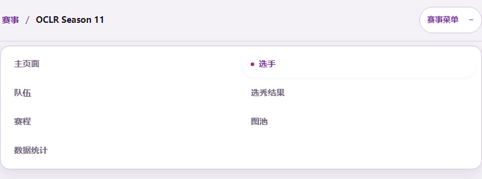
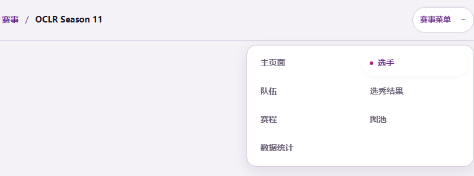
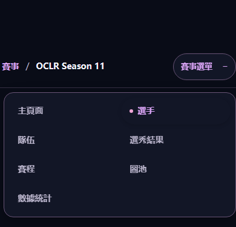

# Small fixes: ranking names and tournament menu (#978, #984)

Base: `95cb55b9` (upstream main).

## Ranking identity

The saved ranking still determines UID, position and every calculated statistic.
At read time, the shared database/page/API model overlays each ranked UID's latest
published `osu_current` observation from the existing durable `player_names`
ledger. Dated observations precede observations with unknown dates; ties use a
stable name/reference order. With no current public observation, the saved
ranking name remains the fallback. Private login evidence and historical aliases
cannot replace the current name. No provider request, ranking recalculation or
business write occurs during the read.

Current remote backends return this same decorated DTO. The frontend preserves
its UID/name mapping without a local database. Backends older than read contract
1.24 keep their existing legacy projection behavior and need a backend upgrade
for the corrected ranking resource.

The integration regression covers newer and older observations, private and
unreleased observations, previous names, identical names on different UIDs,
updates without ranking regeneration, and unchanged ranking/history rows. The
existing cold/warm read tests cover historical fallback and read-only behavior.

## Menu geometry

The existing container breakpoint, two columns, appearance tokens and disclosure
behavior remain in use. The expanded menu is aligned to the context bar's end
and capped at 24rem, shrinking to the available width on narrow screens. Labels
can wrap. Link targets retain their existing 44px minimum height.

The DB-free browser host renders the real `TournamentShell`, translations and
source styles. The focused desktop/mobile test covers width, trigger alignment,
current-page marking, keyboard entry, Escape/focus return, and route selection.
One-off previews also checked Simplified Chinese/light, Traditional Chinese/dark
and English/dark, with no horizontal overflow.

| Preview                    | Viewport | Context bar | Expanded menu |
| -------------------------- | -------- | ----------- | ------------- |
| Simplified Chinese, before | 1440px   | 800px       | 800px         |
| Simplified Chinese, after  | 1440px   | 800px       | 384px         |
| Traditional Chinese, dark  | 390px    | 390px       | 384px         |
| English, dark              | 1440px   | 800px       | 384px         |

The screenshots use synthetic component fixtures. The desktop canvas is limited
to 50rem to exercise the existing collapsed-menu container breakpoint at a wide
viewport. The before screenshot reinstates the original `inset-inline: 0;
width: 100%` rule in the same host. Unrelated fixture content is hidden for the
comparison; these are not production screenshots.

Before:

After:

Mobile, dark:

## Verification

- `npm ci` completed using Node 24 and the existing lockfile.
- Focused ranking integration/remote regressions: 6 passed.
- Focused menu component browser regressions: 2 passed (desktop/mobile).
- `npm audit --omit=dev`: zero vulnerabilities.
- `npm run check`, production build and read-API checks passed. The initial
  generation checks detected Windows CRLF differences; regenerating produced no
  Git content changes and the checks then passed.
- The full unit/integration run reports unrelated replay/shell failures and a
  historical migration timeout on this Windows host. These were also reproduced
  on unmodified `95cb55b9` in a separate database. See the PR for final run counts.
- Baseline comparison: the replay attachment suite reproduced the same 7 failing
  cases; 16 selected existing unit suites produced 71 failures in 15 suites and
  one Windows socket error; the historical migration suite reproduced its 60s
  timeout. This is not a claim that the complete suite passed.
- Full E2E suite not run (too slow); browser verification is limited to this
  reported menu behavior.

Database checks use a newly initialized loopback-only PostgreSQL instance and
the disposable `oclr_test_978_984` database. All data is synthetic. CI and
maintainer review are separate from these local checks.
