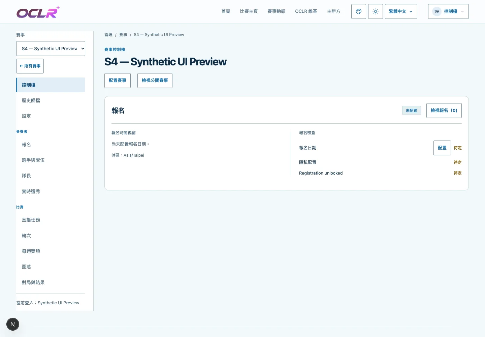
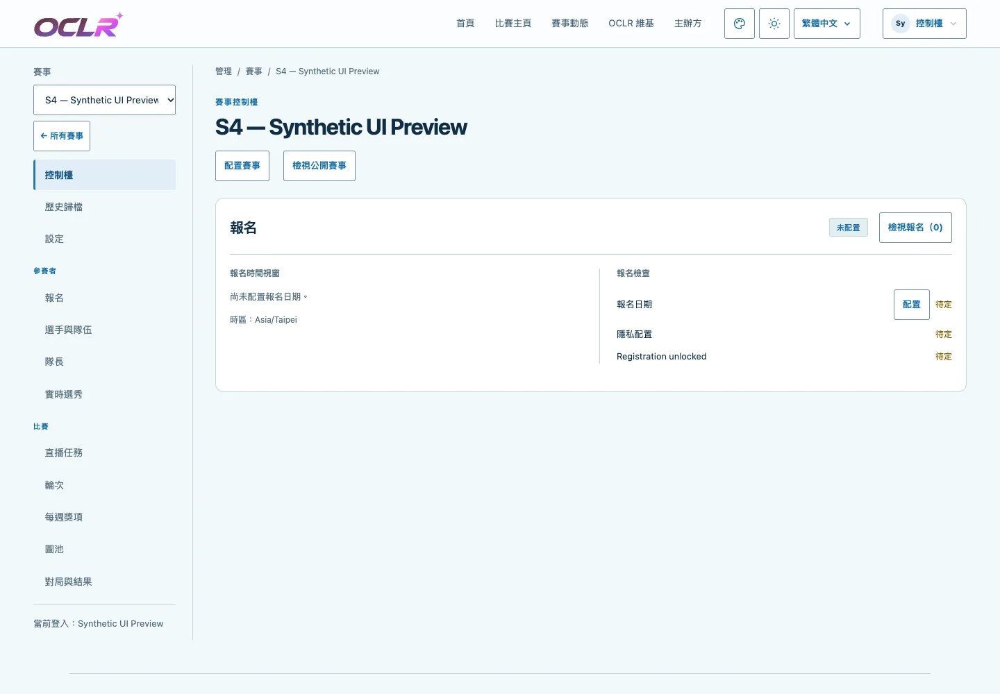
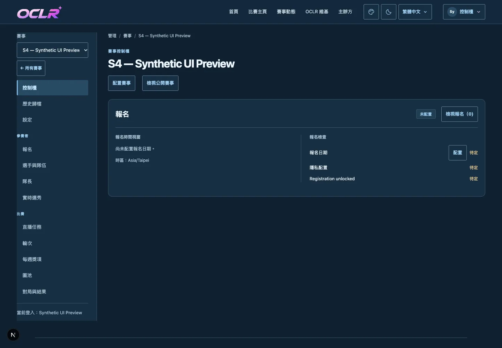
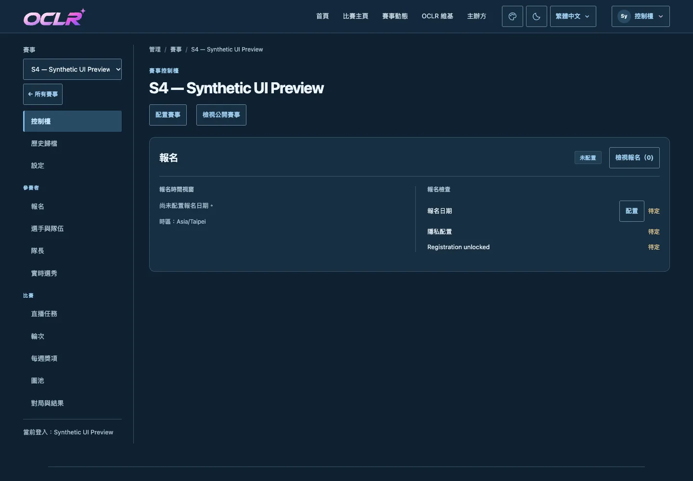
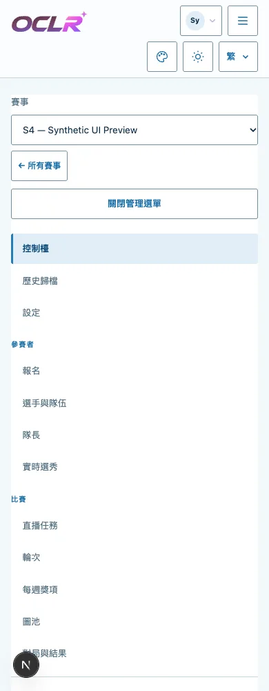
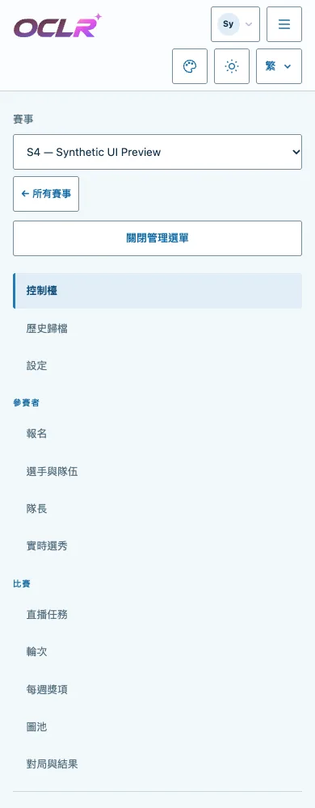

# S4–S9 workspace sidebar backgrounds

Follow-up to #475, 2026-10-29 Asia/Taipei, based on main `510e77da74558552c8d94f53bd40f772523b9701`.

The organizer's S4 screenshot shows an unframed white sidebar against the pale blue page. S4–S8 paint this region with `--site-surface`; S9 uses `--site-header`. All six sidebars now use a transparent background, revealing the existing page colour in light and dark modes. Dividers, selected/hover/focus states, cards and the page palettes are unchanged.

The change is scoped to the existing appearance selectors and `.themed-site`. Season themes still come only from authorized edition configuration under #445. No public theme choice, permission, data, publication or artwork changes are introduced.

## Actual application comparison

These are real Admin routes using six explicitly synthetic editions in a task-owned test database and a synthetic UI account. Before uses the development server; after uses the production build. They do not show production registrations or organizer configuration.

S4 desktop, light:

S4 desktop, dark:

S4 mobile menu, light:

## Verification scope

[Before](before.json) and [after](after.json) reports record the base, stylesheet SHA-256 values, real server-rendered edition appearance, palette, sidebar, card and link states. The after report also binds the production build ID.

The Admin matrix covers all six appearances × light/dark × 320/390/768/1440px in `zh-Hant`. It compares page/card/selected/inactive colours and content hashes against the before state, checks sidebar transparency, hover and keyboard focus, mobile menu toggling, document overflow and page errors, and runs Axe AA. A separate forced-colour matrix covers all six themes × light/dark × 390/1440px, including the existing selection outline or distinct font weight and visible keyboard focus.

## Results

- 48 Admin UI cases and 48 Axe AA scans passed, with no violations, document overflow or page errors. All six final stylesheet hashes match the production report.
- 24 forced-colour cases passed. Existing page palettes, cards, selected/inactive states and content hashes match the before state. Mobile menus open and close normally.
- Node.js 24.22.1 locked `npm ci`, `npm run check` and production build passed. Lint reported nine existing unused-import warnings in the baseline theme tests, with zero errors. Complete unit/integration suite: 186 files, 1546 passed, 1 skipped. Production dependency audit: zero vulnerabilities.
- Existing S4–S9 appearance and Admin-only season-policy desktop/mobile suites: 28 passed initially; two S7 mappool cases exposed an outdated expectation from before shared band cards (#420). The existing test now verifies separate title/artist/difficulty, complete accessible action names, contained title geometry and the existing keyboard/dialog flow. The two affected desktop/mobile cases passed on the focused rerun (50.2s). The other 28 were not repeated. Final typecheck, changed-test lint and formatting passed; the unchanged test import retains its baseline lint warning.

No complete functional/header/remote or Safari acceptance is implied. After verification, the task-owned preview server was stopped and its preview/unit/browser test databases were dropped. The existing shared temporary PostgreSQL server and all other databases were left unchanged.
